# AweAgent 项目工程解析（Mermaid 图解版）

| 项 | 内容 |
|---|---|
| 分析对象 | `E:\Deeplearning\local_train\swefactory_self`（AweAgent v0.1.0，Apache-2.0） |
| 一句话定位 | 一个统一、可组合的 agent 框架：同一套执行核心上构建 / 评测 / 训练搜索、编码、终端三类 agent |
| 代码规模 | 195 个 `.py` / 29,398 行；其中 `aweagent/` 147 文件 19,660 行，`tests/` 25 文件 4,569 行，`recipes/` 14 文件 4,354 行；24 个 YAML 配置 |
| 主要依赖 | pydantic 2 · openai / anthropic SDK · docker SDK · aiohttp · tiktoken · tenacity · structlog |
| 分析方式 | 4 路并行只读深读（scaffold / tasks+eval / llm+tool+runtime / config+RL+test）＋ 主线交叉核对 |
| 结论口径 | 【事实】＝源码、配置或测试可直接核对；【推断】＝由代码结构推出、未运行验证 |
| 日期 | 2026-10-20 |

> 本文档只做工程解析，**不修改任何业务代码**。分析开始时仓库工作区干净；最终 `git status` 只多出本文档所在目录（`docs/工程问题/` 未跟踪）。全程未启动 Docker、未调用外部 LLM API、未下载数据集。
>
> **迁移记录（2026-10-20）**：项目由 `E:\Deeplearning\swefactory_self` 迁至 `E:\Deeplearning\local_train\swefactory_self`。迁移按「复制 → 逐文件 SHA256 比对（290 文件 / 95 目录全部一致）→ `git fsck` 通过（HEAD `0eabe14`、分支 `main`、remote 不变）→ 删除源内容」执行；旧路径已完全移除（会话目录切换后释放占用）。本文所有行号与结论基于迁移后仓库，内容未变。

---

## 0. 结论速览

**AweAgent 的工程内核只有一句话：把 agent 拆成 `策略（scaffold）`、`执行引擎（loop）`、`状态总线（context）` 三件正交的东西，其余能力（LLM、工具、沙箱、任务、评测、RL）全部通过小协议 + 注册表接入。**

由此带来四个可直接观察到的工程后果：

1. **同一执行核心服务三类任务**：编码（SearchSWE / OpenHands-style）、搜索问答（DeepSearch / IterResearch）、终端（Terminus-2）共用 `AgentLoop`，差异被压缩进 `step(ctx) -> Action` 与三种 tool-call 格式。
2. **一个 `enable_search` 开关就切换 OpenHands-style 与 SearchSWE**，不是两套代码（`README.md:44`、`aweagent/scaffold/search_swe/agent.py:138`）。
3. **评测被抽象成三种拓扑**：隔离容器打 patch（6 条 benchmark 路径 + 通用回退）、同容器 reward（Terminal-Bench v2）、无容器 LLM-as-Judge（BrowseComp），由 `Task.requires_*` 与 `Evaluator.requires_same_session` 两个正交开关编排。
4. **训练即推理 + 一个字段**：注入 `AgentContext.training = TrainingState(...)` 后，同一个 `AgentLoop` 顺带累积 token 级 rollout 数据（`loss_mask` / `logprobs` / `weight_version`），再由 `integrations/slime.py` 导出。

**三条最值得注意的工程风险**（详见 §13）：

- `configs/tasks/nl2repo.yaml` 与 `configs/tasks/swe_bench_pro.yaml` 默认 `runtime.backend: portal`，但仓库**没有** `PortalRuntime` 实现，只有 `docker` 内建注册——开箱即跑这两份配置会 `KeyError`。【事实】
- `awe-agent run` 的 `_build_task` **没有 `denovo_swe` 分支**，而 `configs/tasks/denovoswe.yaml` 正是该类型，只能走 `recipes/denovo_swe/run.py`。【事实】
- `pyproject.toml` 声明的 `aweagent.evaluator` entry-point 组**只注册、从不按名解析**，评测实际走 `Task.default_evaluator()`；`cache` 配置同理（已建模、无实现）。【事实】

---

## 1. 总体架构

### 1.1 四层 + 一条侧链

与 `assets/architecture.png` 一致，代码的真实分层是「任务层 → 执行核心 → 交互层 → 评测与数据层」，配置/注册表作为侧链贯穿所有层。

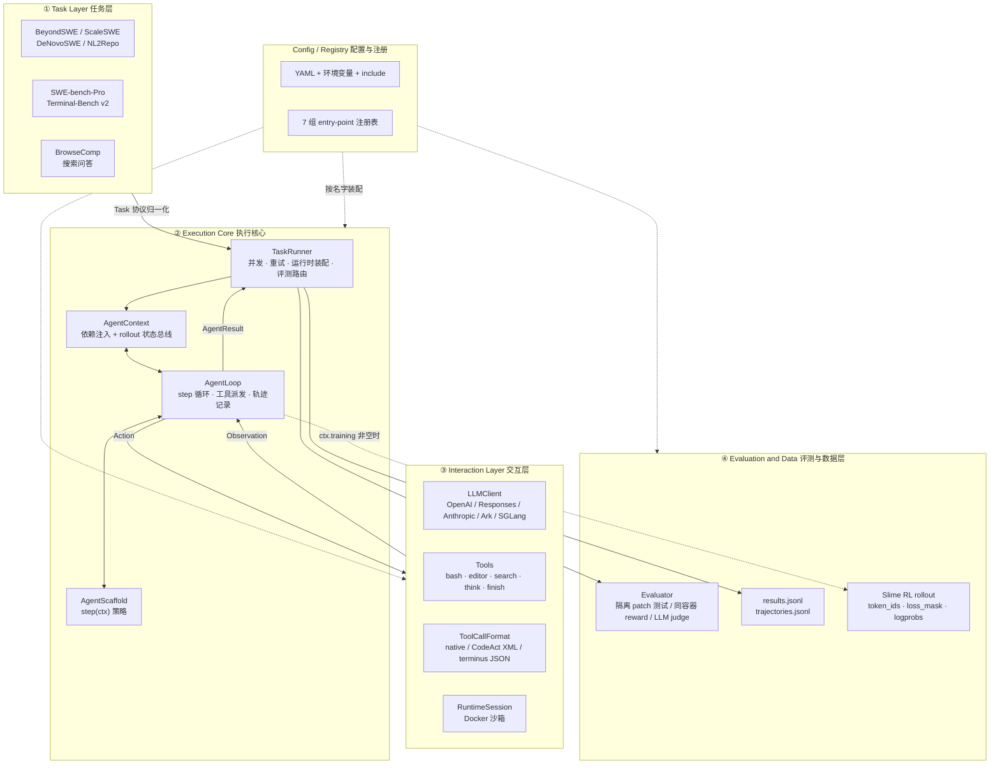

【事实】分层证据：`README.md:133-149`、`aweagent/core/agent/context.py:29-77`、`aweagent/core/task/runner.py:143-196`、`aweagent/core/agent/loop.py:47-95`。四层的实际耦合点只有 `AgentContext` 与 `AgentResult` 两个数据结构。

### 1.2 包级模块依赖

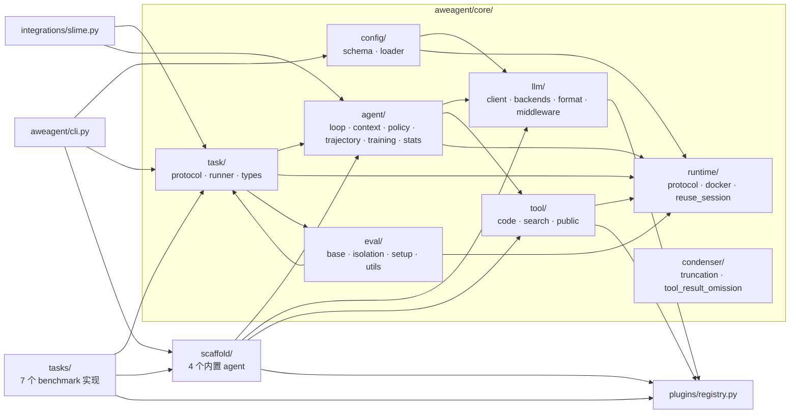

【事实】`core/` 内部依赖方向是「task → agent → llm/tool/runtime」，`scaffold/` 与 `tasks/` 只依赖 `core` 的协议，`integrations/slime.py` 复用 `task/runner` 与 `agent/*`。没有反向依赖（`core` 不 import `scaffold`/`tasks`），这是「注册表在外部装配」的结构保证。【推断】

### 1.3 模块职责表

| 模块 | 关键文件 | 职责 | 对外协议 |
|---|---|---|---|
| `core/agent` | `loop.py` `context.py` `protocol.py` `policy.py` `trajectory.py` `training.py` `stats.py` | 执行引擎、上下文总线、生命周期钩子、轨迹与 RL 累加器 | `Agent`、`LoopPolicy`、`AgentContext`、`AgentResult` |
| `core/task` | `protocol.py` `runner.py` `types.py` | 批量调度、钩子编排、结果落盘 | `Task`、`Evaluator`、`Instance`、`EvalResult` |
| `core/llm` | `client.py` `types.py` `backends/*` `format/*` `middleware/*` | 统一 LLM 调用、多方言适配、tool-call 编解码、重试与追踪 | `LLMBackend`、`ToolCallFormat`、`Message`/`LLMResponse` |
| `core/tool` | `protocol.py` `registry.py` `code/*` `search/*` `public/*` | 8 个内置工具与搜索/读取后端 | `Tool`（`name`/`schema`/`execute`） |
| `core/runtime` | `protocol.py` `docker.py` `reuse_session.py` | 容器会话、patch 提取与应用、同会话评测适配 | `Runtime`、`RuntimeSession` |
| `core/eval` | `base.py` `isolation.py` `setup.py` `utils.py` | 隔离评测模板、通用脚本评测、防泄漏快照、F2P/P2P 解析 | `PatchTestEvaluator`、`IsolatedEvaluator`、`PreAgentSetup` |
| `core/config` | `schema.py` `loader.py` | Pydantic 配置模型与六步加载流水线 | `AweAgentConfig` |
| `core/condenser` | `truncation.py` `tool_result_omission.py` | 上下文压缩（按消息条数 / 按旧工具轮） | `Condenser.condense(messages)` |
| `plugins` | `registry.py` | 通用命名注册表（内置注册 + entry-point 懒发现） | `Registry.get(name)` |
| `scaffold` | `search_swe/` `deepsearch/` `iter_research/` `terminus_2/` | agent 策略与提示词 | `Agent` 子类 |
| `tasks` | 7 个 benchmark 子目录 | Task/Evaluator 语义、prompt 路由、反作弊约束 | `Task` / `Evaluator` 子类 |
| `integrations` | `slime.py` | RL rollout 桥接与 `Sample` 导出 | `generate_rollout_fully_async` |

---

## 2. 一条 run 的完整生命周期

### 2.1 装配：从 YAML 到 `TaskRunner`

`awe-agent run -c config.yaml` 与 `recipes/*/run.py` 是两条等价入口（都组装 `TaskRunner`），后者的 debug 模式会自行复刻 runner 生命周期（见 §13-R8）。

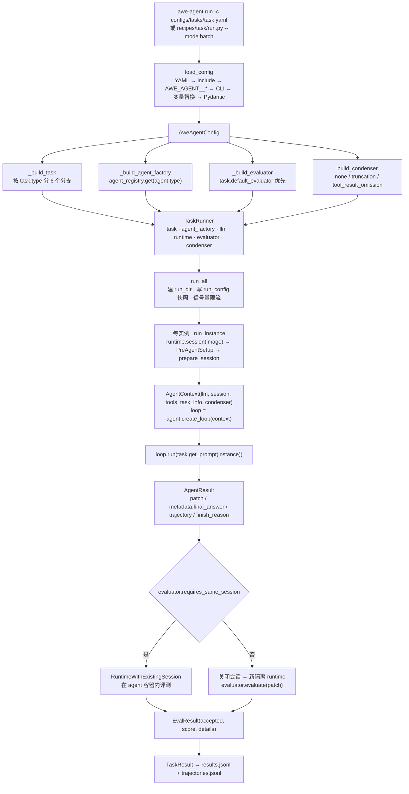

【事实】`aweagent/cli.py:115-179`、`aweagent/core/config/loader.py:56-97`、`aweagent/core/task/runner.py:198-244`、`aweagent/core/task/runner.py:329-444`。

### 2.2 编排时序：`TaskRunner` 与各钩子的调用顺序

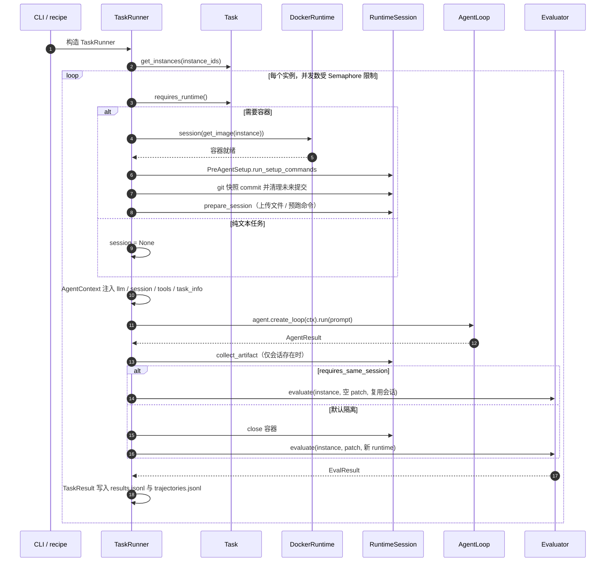

【事实】钩子顺序严格固定：`requires_runtime`（`runner.py:320`）→ setup（`:348`）→ snapshot（`:351-353`）→ `prepare_session`（`:356`）→ `get_search_constraints`/`get_llm_overrides`/`get_task_info`（`:359-373`）→ `get_prompt` + `loop.run`（`:389-410`）→ `requires_agent_result_evaluation`（`:412-417`）→ `collect_artifact`（`:424`）→ 同会话/隔离评测（`:431-444`）。

### 2.3 `AgentLoop` 的单次 rollout：状态机与终止条件

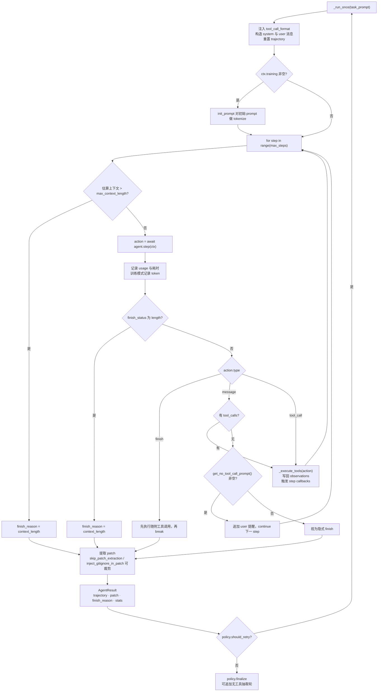

【事实】终止条件优先级（`aweagent/core/agent/loop.py:146-167`）：上下文超限 → 训练 token 预算耗尽 → 显式 `finish` → 无工具调用且有提醒（继续）→ 无工具调用无提醒（隐式 finish）→ `max_steps` → 异常。`patch` 抽取在循环结束后进行，`skip_patch_extraction` 与 `inject_gitignore_in_patch` 由 `task_info` 控制（`loop.py:347-372`）。

### 2.4 单 step 时序：策略 → LLM → 工具 → 观测

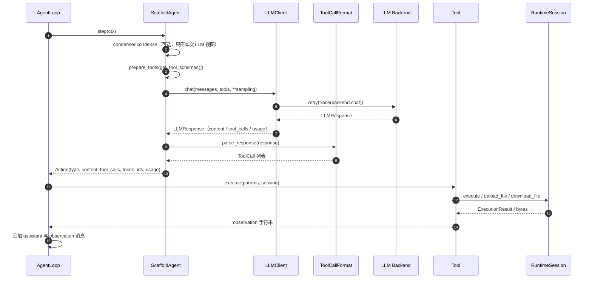

【事实】`aweagent/scaffold/search_swe/agent.py:236-307`（step 主流程）、`aweagent/core/agent/loop.py:397-495`（工具执行与消息写回）。注意 `Tool.execute` 的真实签名是 `execute(params, session)`，没有注入回调函数（`aweagent/core/tool/protocol.py:49-64`）。

### 2.5 结果落盘

| 文件 | 内容 | 证据 |
|---|---|---|
| `results/<model>_<timestamp>/results.jsonl` | `instance_id`、`dataset_id`、`task`、`success`、`score`、`error`、`finish_reason` | `task/runner.py:262-271` |
| 同目录 `trajectories.jsonl` | `patch`、`stats`、`trajectory[]`、`messages[]`、`eval_result`（`asdict`）、文本答案任务的 `final_answer` / `answer_provenance` | `task/runner.py:100-140`、`:274-281` |
| 同目录 `run_config.json` | 运行元数据与配置快照，递归剔除 `api_key`/`token`/`password` 等键 | `task/runner.py:65-97`、`:213-217` |

【事实】run 目录命名规则 `base / <sanitized_model>_<YYYYMMDD_HHMMSS>`（`runner.py:46-62`）；重试 3 次仍失败时也会写一行 `success=false`，保证失败可见（`runner.py:296-314`）。

---

## 3. 执行核心：为什么 agent 只写一个 `step()`

### 3.1 三个对象的职责边界

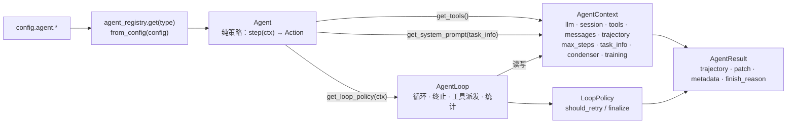

| 对象 | 位置 | 职责 | 关键约束 |
|---|---|---|---|
| `Agent` | `core/agent/protocol.py:23-107` | 纯策略：`step(ctx)`、system prompt、工具目录、tool-call 格式、loop policy | 无状态；状态全在 `AgentContext` |
| `AgentContext` | `core/agent/context.py:28-77` | 依赖注入与 rollout 状态总线 | 唯一连接 agent 与外界的接缝 |
| `AgentLoop` | `core/agent/loop.py:47-521` | 循环、终止判定、工具执行、统计、RL token 累积 | 只按 action 的 *kind* 分支，不感知任务类型 |
| `LoopPolicy` | `core/agent/policy.py:24-80` | 单次 rollout 之外的生命周期：重跑与收尾变换 | 默认 no-op；`CompositePolicy` 可组合 |

【事实】`Agent.create_loop()` 默认返回 `AgentLoop(self, ctx, policy=self.get_loop_policy(ctx))`（`protocol.py:71-79`）；只有 IterResearch 覆写它。`LoopPolicy` 的两个钩子：`should_retry(attempt, result, ctx)` 与 `finalize(loop, result, ctx)`（`policy.py:27-51`），后者可借 `AgentLoop.append_extraction_turn()` 追加无工具抽取轮（`loop.py:96-144`）。

### 3.2 `Action` 与 `AgentResult`：跨层契约

`Action` 只有三种 kind：`finish` / `message` / `tool_call`，除内容与工具调用外，还携带 RL 字段（`token_ids`、`logprobs`、`weight_version`、`finish_status`）与 `usage`（`core/agent/trajectory.py:9-28`）。`AgentResult` 统一承载 `trajectory`、`patch`、`messages`、`finish_reason`（`finish|max_steps|context_length|error|timeout`）、`error`、`metadata`（`loop.py:35-44`）。

【事实】文本答案类 scaffold 把答案放进 `metadata["final_answer"]`，并附 `answer_provenance`；runner 再把它转存到 `instance.metadata["_agent_final_answer"]` 供 evaluator 读取（`runner.py:412-417`）。

### 3.3 统计与轨迹

- `RunStats`：总耗时、LLM 耗时、工具耗时、step 数、LLM 调用数、工具使用计数、prompt/completion token（`core/agent/stats.py:11-78`）。
- `Trajectory`：每步 `Action` + `observations` + `reward`，支持导出 `to_messages()` 与 `to_training_format()`（`core/agent/trajectory.py:31-129`）。

---

## 4. Scaffold 层：四种策略，一个引擎

### 4.1 族谱与 loop 拓扑

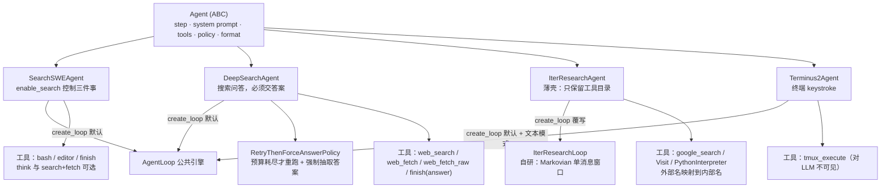

【事实】注册表只有 4 个名字：`search_swe`、`deepsearch`、`iter_research`、`terminus_2`（`aweagent/scaffold/registry.py:9-23`；`terminus_2` 惰性注册）。`IterResearchAgent.step()` 故意抛 `NotImplementedError`，`create_loop` 返回自研 loop（`scaffold/iter_research/agent.py:359-377`），runner 按鸭子类型调用 `loop.run(prompt)`。

### 4.2 四个 scaffold 的核心差异

| 维度 | SearchSWE / OpenHands-style | DeepSearch | IterResearch | Terminus-2 |
|---|---|---|---|---|
| 类 | `SearchSWEAgent` | `DeepSearchAgent` | `IterResearchAgent` | `Terminus2Agent` |
| loop | 公共 `AgentLoop` | 公共 `AgentLoop` + policy | **自研 `IterResearchLoop`** | 公共 `AgentLoop` |
| system prompt | 任务层注册表 + 路由 | 内联 + 工具名 + 当前时间 | **空** | **空** |
| user prompt 来源 | Task 层 | Task 层 | loop 每轮重建 | Task 提供模板，agent 首步填充 |
| tool-call 格式 | native（默认）/ CodeAct XML | 同左 | 手写 `<tool_call>` JSON，`tools=None` | terminus JSON（合成工具调用） |
| 终止信号 | `finish` 工具 | `finish(answer=...)` | 无 `<tool_call>`（`<answer>` 或文本） | 二次 `task_complete` |
| 运行时依赖 | bash（容器） | 无 shell | 无 shell（远端 Python 沙箱） | tmux（容器） |

【事实】`enable_search` 同时决定三件事：是否加 Web 工具、是否追加「非搜索模式」bash 黑名单、system prompt 走哪条路由（`scaffold/search_swe/agent.py:159-200`）；同一个字段还以 `search_mode` 传给 Task 选择 user prompt（`cli.py:192`、`prompts/config.py:33-57`）。

### 4.3 Terminus-2：把「敲键盘」编码成一次工具调用

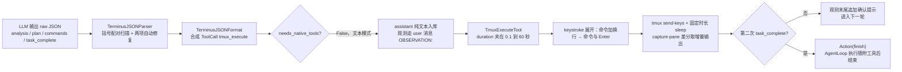

【事实】解析器容错：补齐未闭合花括号、从混合文本中抠最内层 JSON（`scaffold/terminus_2/parser.py:35-51,181-207`）；`block=False` 走固定 `sleep(duration)` 而非 `tmux wait` 同步（`tmux_tool.py:102-106`、`tmux_session.py:129-133`）——duration 因此是最关键的时序参数，prompt 反复强调它（`tasks/terminal_bench_v2/prompt/json_plain.txt:39-41`）。

### 4.4 IterResearch：用「丢弃历史」换更多轮交互

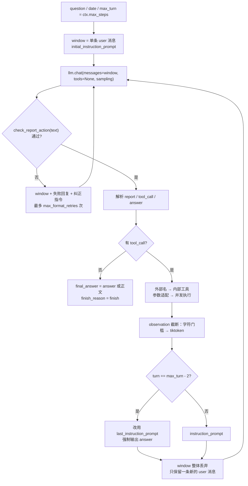

【事实】窗口是「整体丢弃再重建」，不是追加（`scaffold/iter_research/loop.py:183-196`）；`max_turn = max(ctx.max_steps, 1)`（`:97`）；最后两轮切到强制作答提示（`:179-181,340`）。README 所说的 “interaction scaling” 在代码中没有独立符号，实现上就是「有界上下文 + 更多轮」（`README.md:41` 与 `iter_research/loop.py` 对照）——属设计后果而非可配置调度器。【推断】

### 4.5 提示词的四套组织方式

| scaffold | 组织方式 | 证据 |
|---|---|---|
| SearchSWE | `prompts/config.py` 路由表 + `system.py` + `user.py` 分文件；user 由 Task 消费 | `scaffold/search_swe/prompts/README.md:61-75` |
| DeepSearch | `config.py` 路由 + `system.py`（内联两套）+ `user.py`（预留）+ `final_answer.py`（强制作答提示） | `scaffold/deepsearch/prompts/` |
| IterResearch | 单文件 `prompts.py` 集中四个模板，每轮重建 | `scaffold/iter_research/prompts.py:20,72,167,244` |
| Terminus-2 | 无 prompts 目录，模板属任务层（`json_plain.txt`），经 `task_info["prompt_template"]` 传入 | `tasks/terminal_bench_v2/task.py:428-446` |

---

## 5. 交互层：可插拔的四个接缝

### 5.1 LLM 调用链：retry 在外、trace 在内

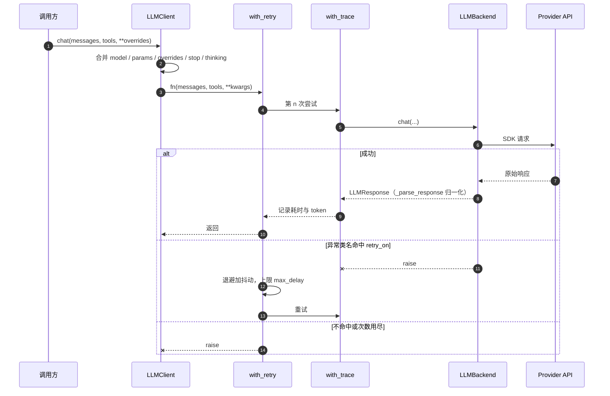

【事实】每次 `chat()` **重建**调用链 `retry(trace(backend.chat))`（`core/llm/client.py:127-130`）；重试判定是「异常类名包含 `retry_on` 子串」（`middleware/retry.py:28-49`），指数/线性/固定退避乘 ±25% 抖动后被 `max_delay` 截断（`retry.py:56-65`）。`cache` 配置已建模但全仓无消费点（`core/llm/config.py:27-31,87`）→【推断】缓存中间件未实现。

### 5.2 后端矩阵（能力差异集中在方言转换与 reasoning 回传）

| 维度 | openai（含 azure 别名） | openai_response | anthropic | ark | sglang |
|---|---|---|---|---|---|
| 客户端 | `AsyncOpenAI`；有 `api_version` 时切 `AsyncAzureOpenAI` | 同左 | `AsyncAnthropic` | `AsyncArk`（需可选依赖） | `aiohttp` 直连 |
| 端点 | `chat.completions.create` | `responses.create` | `messages.create` | `chat.completions.create` | 有 `input_ids` 走 `/generate`，否则 `/v1/chat/completions` |
| system | 留在 messages | 提为 `instructions` | 提为顶层 `system` | 留在 messages | 留在 messages |
| tool 格式 | 原样透传 | 转 responses 工具结构 | 转 `input_schema` | 原样透传 | `/v1` 透传；`/generate` 无 tools |
| reasoning 回传 | 默认**剥离**（显式 `preserve` 才保留） | 增量或全量二选一 | 全块按原序重放 | **无条件**回传 | 不解析 |
| RL 字段 | 无 | 无 | 无 | 无 | **有**：token ids / logprobs / weight_version |

【事实】`pyproject.toml:36-42`、`core/llm/backends/openai.py:89-118`、`openai_response.py:203-224`、`anthropic.py:174-227`、`ark.py:74-83`、`sglang.py:114-145`。统一契约只有两个：输入 `Message`、输出 `LLMResponse`；`Message.to_dict()` 刻意不含 reasoning 以保持 OpenAI 兼容，`to_full_dict()` 才导出（`llm/types.py:26-44`）。

### 5.3 ToolCallFormat：一个判据决定消息形态

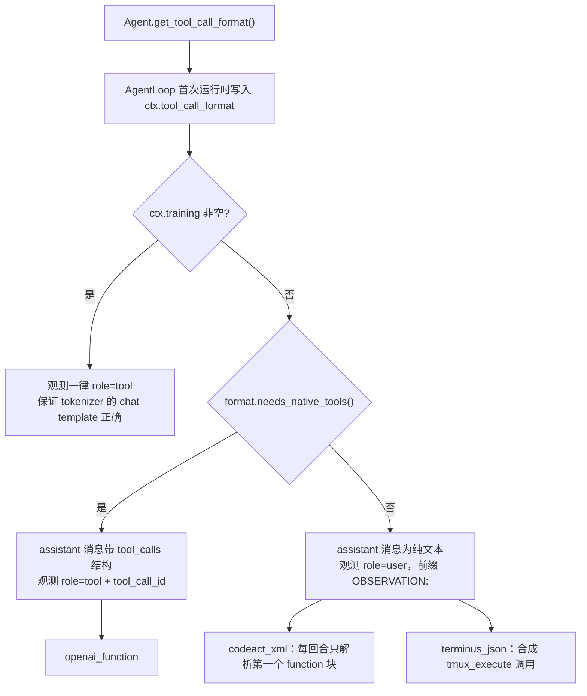

【事实】`needs_native_tools()` 全仓只被 loop 消费一次（`core/agent/loop.py:406-411`），但它同时决定 assistant 消息形态与观测 role（`loop.py:413-481`）。文本格式的工具描述由 `get_system_prompt_suffix()` 注入 system（`format/xml.py:47-132`），因此 API 层 `tools` 传 `None`。

### 5.4 工具清单与安全约束

| 工具 | 需要 session | 关键行为 | 安全/限制 |
|---|---|---|---|
| `execute_bash` | 是 | 执行命令，输出超 32000 字符时保留头尾并提示截断 | 正则 blocklist 先于执行；单命令超时上限 600s |
| `str_replace_editor` | 是 | view / create / str_replace / insert；不唯一匹配即拒绝 | 无路径白名单，依赖容器隔离 |
| `think` | 否 | 只记录思考，无副作用 | — |
| `finish` 家族 | 否 | 恒返回完成文案；提交物由变体解析 | loop 以工具名判定终止 |
| `web_search` | 否 | 支持批量查询，结果按约束过滤并提示过滤条数 | repo 级 URL/标题正则黑名单 |
| `web_fetch` | 否 | 抓取后按 prompt 用 LLM 总结，失败回退原文 | 命中约束返回 `ACCESS DENIED` |
| `web_fetch_raw` | 否 | reader 后端抓取 + tiktoken 截断 | 同上 |
| `python_interpreter` | 否 | 远端 SandboxFusion 执行，不在容器内 | 依赖 `sandbox_fusion` 客户端；工具描述声明无本地文件/外网访问 |

【事实】`core/tool/code/bash.py:98-150`、`editor.py:65-327`、`search/web_search_tool.py:84-253`、`web_fetch_tool.py:68-291`、`web_fetch_raw_tool.py:69-195`、`public/python_interpreter.py:100-231`。

bash 约束是三层叠加（`scaffold/search_swe/agent.py:38-60,152-167`）：

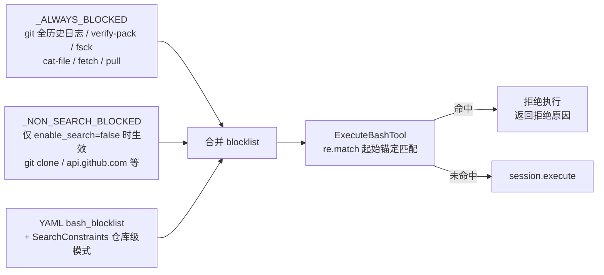

【事实】匹配用 `re.match`（起始锚定、无 IGNORECASE），模式需自带 `(?i)` 与前置 `.*`（`core/tool/code/bash.py:38,105-108`；`search/package_constraints.py:27-37`）。

### 5.5 Docker 会话状态机

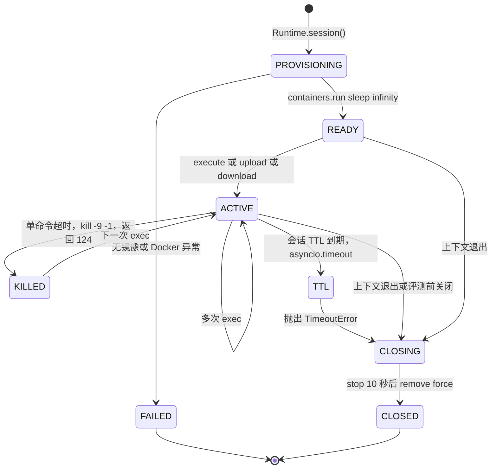

【事实】创建时 `mem_limit` 与 `nano_cpus` 由配置解析而来，网络默认 `bridge`（`core/runtime/docker.py:167-217`）；单命令超时先 `kill -9 -1` 再返回 `exit_code=124`（`docker.py:57-80`）；会话 TTL 由协议层 `asyncio.timeout(config.timeout)` 兜底，`finally` 必然 `close()`（`runtime/protocol.py:257-284`）。`get_patch()` 先幂等注入语言级 `.gitignore` 块，再 `git add -A && git diff --cached [base]`（`runtime/protocol.py:143-203`）；`apply_patch()` 尝试 6 种策略（`protocol.py:205-228`）。

---

## 6. 评测与数据层

### 6.1 两个易混开关是正交的

| 开关 | 归属 | 回答的问题 | 使用者 |
|---|---|---|---|
| `Evaluator.requires_same_session` | Evaluator property | **在哪个容器里评** | Terminal-Bench v2 |
| `Task.requires_agent_result_evaluation` | Task 方法 | **评测消费什么输入**（patch 还是文本答案） | BrowseComp |
| `Task.requires_runtime` | Task 方法 | 是否需要容器 | BrowseComp（False） |
| `Task.requires_git_snapshot` | Task 方法 | 是否做 pre-agent git 快照 | NL2Repo / SWE-bench-Pro / TB2（False） |
| `Task.requires_patch_extraction` | Task 方法 | 是否 `git diff` 抽 patch | NL2Repo（False） |

【事实】`core/task/protocol.py:84-126,196-206`；runner 分别消费于 `runner.py:320,351,372,412,431,437`。`requires_git_snapshot` 与 `requires_patch_extraction` 故意解耦，以支持「不做快照、仍对 base_commit 抽 patch」的 SWE-bench-Pro 流程（`protocol.py:102-105`）。

### 6.2 三种评测拓扑

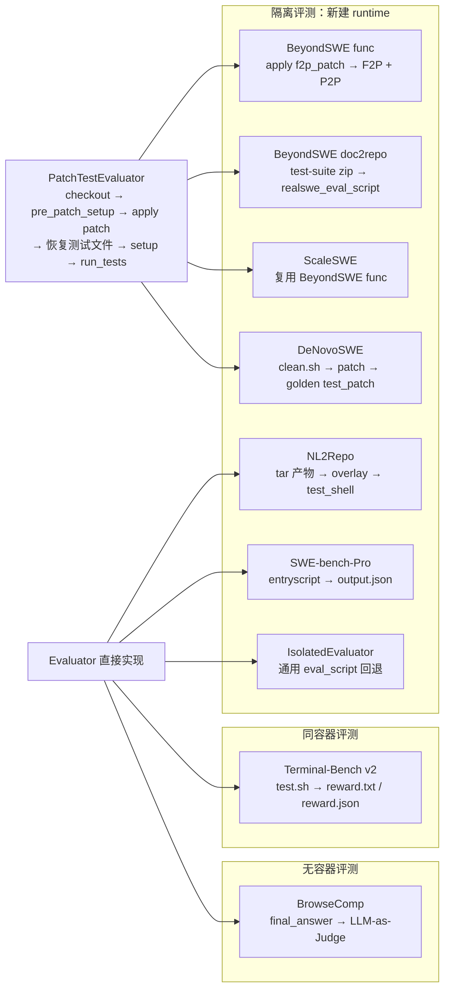

【事实】`core/eval/base.py:35-180`、`core/eval/isolation.py:20-97`、`core/runtime/reuse_session.py:16-65`。同容器评测用 `RuntimeWithExistingSession` 包装：`close()` 为 no-op、评测 patch 传空串（`task/runner.py:480-495`）。

### 6.3 各 benchmark 的评分口径

| Benchmark | accepted 判据 | score | 评测位置 |
|---|---|---|---|
| BeyondSWE（func 级） | F2P 与 P2P 全过 | 1 / 0 | 隔离容器 |
| BeyondSWE（doc2repo） | 输出含 `<pytest>true</pytest>` | 1.0，否则 pass_rate | 隔离容器 |
| ScaleSWE | 同 BeyondSWE func | 1 / 0 | 隔离容器 |
| DeNovoSWE | `passed == expected` 且 failed/errors 为 0 | 1.0，否则 pass_rate | 隔离容器 |
| NL2Repo | passed ≥ 期望用例数且无失败/错误 | `min(passed/expected, 1)` | 隔离容器（换 eval 镜像） |
| SWE-bench-Pro | 期望测试集 ⊆ `output.json` 中 PASSED | 1 / 0 | 隔离容器（预置 eval assets） |
| Terminal-Bench v2 | `reward > 0` | `reward` | **同容器** |
| BrowseComp | judge 判 `yes` | 1 / 0 | **无容器**（LLM judge） |

【事实】`aweagent/tasks/*/evaluator.py` 与 `docs` 笔记交叉核对；`EvalResult` 只有 `accepted`、`score`、`details`、`duration` 四个字段（`core/task/types.py:31-38`），`TaskResult.success ⇔ eval_result.accepted`（`types.py:51-53`）。

### 6.4 数据资产流：datasets → configs → Task → Evaluator

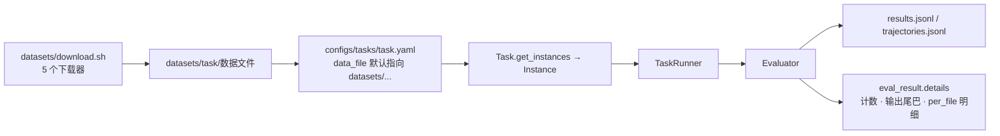

【事实】下载产物落 `datasets/<task>/`，配置用 `${VAR:-datasets/...}` 做默认值，因此下载后无需设环境变量（`datasets/README.md:5-24`）；实际登记 5 个下载器，文档仍写 3 个（`datasets/download.sh:17` 对照 `datasets/README.md:25-33`）。SWE-bench Verified 不在 `aweagent/tasks/` 内，而是 `recipes/scale_swe/swebench_verified/` 的**复现配方**：推理走 ScaleSWE 配方导出 predictions，评测交给外部 `swebench` harness（`recipes/scale_swe/swebench_verified/README.md:12,236-245`）。

---

## 7. 配置与注册：所有组件按名字接入

### 7.1 配置的六步流水线

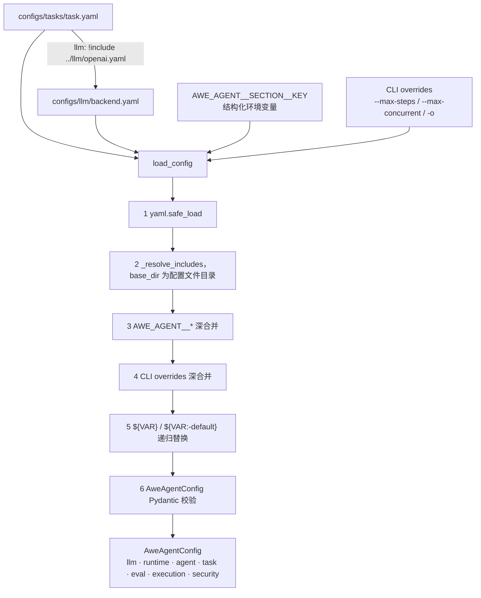

【事实】`core/config/loader.py:56-97`。两个易踩的细节：`!include` 是**字符串前缀**约定（必须写成带引号的 `"!include path"`），只递归 dict、不嵌套、整段替换；`${VAR}` 缺省且无默认时**保留字面量**而不报错（`loader.py:140-176`）。`configs/default.yaml` 不是自动基底——`load_config` 只读显式传入的文件，全仓唯一引用是 `examples/batch_evaluation.py:50`。

### 7.2 七组 entry-point 与懒发现

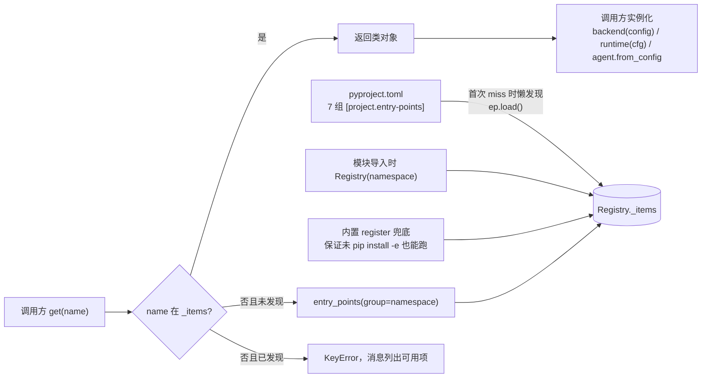

【事实】`plugins/registry.py:35-95`；内置注册优先于 entry point，因为发现阶段跳过已存在的键（`registry.py:81`）。七组分别是：`llm_backend`、`runtime`、`agent`、`evaluator`、`search_backend`、`reader_backend`、`tool`（`pyproject.toml:36-72`）。其中 **`evaluator` 组未被按名解析**（全仓无 `evaluator_registry.get(...)`），`awe-agent info` 也只打印 4 组（`cli.py:87-112`）。

### 7.3 CLI 能力边界

| 命令 | 行为 | 边界 |
|---|---|---|
| `awe-agent run -c <yaml>` | 装配置、建 Task/Agent/Evaluator、跑 `TaskRunner` | `_build_task` 只硬编码 6 类 task，**无 `denovo_swe`**（`cli.py:182-249`） |
| `awe-agent info` | 打印 LLM / Runtime / Agent / Tool 四组可用项 | 不显示 search/reader/evaluator 三组 |
| `--dry-run` | 只加载实例并打印前 20 条 | 不建容器 |

---

## 8. 训练路径：同一个 loop，多一份 token 账本

### 8.1 token 累积与导出时序

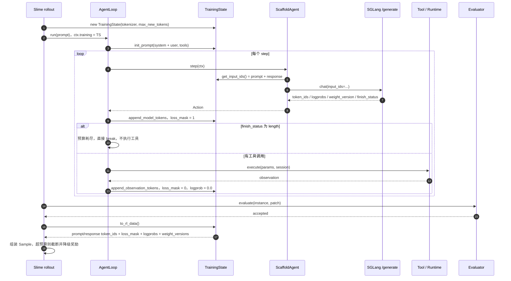

【事实】`core/agent/training.py:38-233`、`core/agent/loop.py:183-191,232-249,483-513`、`core/llm/backends/sglang.py:54-145`、`integrations/slime.py:320-378`。只有 SGLang backend 填充 `completion_token_ids` / `logprobs` / `weight_version` / `finish_status`（`llm/types.py:109-114`）；其余 backend 留 `None`，训练路径因此实际绑定 SGLang。

### 8.2 关键设计点

| 设计 | 说明 | 证据 |
|---|---|---|
| 零开销开关 | `ctx.training is None` 时所有训练逻辑不执行 | `context.py:66-67`、`loop.py:184,233,459` |
| 续写模式 | 有 `input_ids` 时走 `/generate`，不再发消息列表 | `search_swe/agent.py:246-249`、`sglang.py:62-68` |
| loss mask | 模型 token 记 1、环境观测 token 记 0；观测的 logprob 补 0.0 | `training.py:119-123,161-166` |
| 预算保护 | 剩余预算 ≤ 0 时只发 1-token 请求取 `weight_version`，返回空 `length` | `sglang.py:84-100,229-261` |
| 导出口径 | `to_rl_data()` 直接映射 Slime `Sample` 字段；超预算截断并把正奖励降级 | `training.py:188-207`、`slime.py:341-367` |

【事实】`Action`/`LLMResponse` 上是单数 `weight_version`，`TrainingState` 累积为列表 `weight_versions`（`training.py:67`）；状态映射 `stop→COMPLETED`、`length→TRUNCATED`、`abort→ABORTED`（`slime.py:371-378`）。

---

## 9. 横切关注点

### 9.1 上下文压缩（condenser）

| 策略 | 触发 | 行为 | 风险 |
|---|---|---|---|
| `truncation` | `len(messages) > max_messages` | 保留头 `keep_first` 条 + 尾若干条，中间丢弃 | 可能切断 tool-call 与观测的配对 |
| `tool_result_omission` | 存在可省略的旧工具轮 | 保留全部消息，只把旧工具结果正文替换为占位符 | 保持结构，原生 tool-calling 历史仍合法 |

【事实】`core/condenser/truncation.py:23-33`、`tool_result_omission.py:25-93`、`condenser/__init__.py:22-38`。压缩只作用于**本次 LLM 调用视图**，`context.messages` 全量保留，因此不影响轨迹与 RL 累积（`scaffold/search_swe/agent.py:238-241`）。

### 9.2 超时与预算：六道闸门（互不替代）

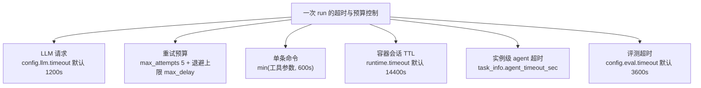

【事实】`llm/config.py:88`、`middleware/retry.py:56-65`、`tool/code/bash.py:120-139`、`runtime/protocol.py:269-282`、`task/runner.py:390-410`、`eval/base.py:60-67`。单命令超时会 `kill -9 -1` 并返回 124，会话仍可复用（`docker.py:57-80`）。

### 9.3 防作弊与防泄漏

| 层面 | 机制 | 证据 |
|---|---|---|
| git 历史 | 快照后重置所有 ref、清 stash/reflog 并 gc，防止未来提交泄漏 | `core/eval/setup.py:34-48,88-92` |
| shell | 三层 bash blocklist（无条件 / 非搜索 / 任务级） | `scaffold/search_swe/agent.py:38-60,152-167` |
| 搜索/抓取 | repo 级 URL 黑名单，fetch 前拦截，结果过滤 | `core/tool/search/constraints.py:36-95` |
| 包安装 | `PackageSearchConstraints` 拦截 `pip install` 上游包 | `core/tool/search/package_constraints.py:1-37` |
| 测试篡改 | 评测前恢复测试文件 / 删除 agent 写的测试 / overlay golden tests | `core/eval/utils.py:221-237`、`tasks/nl2repo/evaluator.py:230-245` |
| 数据明文 | BrowseComp 保持 canary 加密，任务内存解密 | `datasets/browsecomp/download.sh:16-17`、`tasks/browsecomp/task.py:302-318` |

### 9.4 可观测性

- `run_dir` 三层产物：`run_config.json`（脱敏配置快照）、`results.jsonl`（每实例一行）、`trajectories.jsonl`（完整轨迹 + 消息 + 评测明细）。
- `RunStats` 随 `AgentResult.metadata["stats"]` 落盘（`loop.py:378`）。
- LLM 层只有 logger 级 trace，无结构化落盘（`middleware/trace.py`）。

---

## 10. 扩展指南：加东西只需要「实现协议 + 注册名字」

```mermaid
flowchart LR
    A["实现协议接口<br/>LLMBackend / Tool / Runtime<br/>/ Agent / Evaluator / Task"] --> B["在 pyproject 或模块内注册名字"]
    B --> C["YAML 写该名字"]
    C --> D["Registry.get(name)<br/>首次 miss 懒加载 entry point"]
    D --> E["运行期实例化并注入 AgentContext"]
    A -.->|"或者"| F["内置 register 兜底注册"]
    F --> D
```

| 想扩展 | 要实现的接口 | 注册位置 | 还要改什么 |
|---|---|---|---|
| LLM 后端 | `LLMBackend.chat()` + `_parse_response()` | `[project.entry-points."aweagent.llm_backend"]` | `configs/llm/*.yaml` 选名字 |
| 工具 | `Tool.name/description/parameters/execute(params, session)` | `[project.entry-points."aweagent.tool"]` | scaffold 的工具目录或 `agent.tools` |
| 运行时 | `Runtime.create_session()` + `RuntimeSession` 四个抽象方法 | `[project.entry-points."aweagent.runtime"]` | 注意内置已注册 docker，同名覆盖只告警 |
| Agent 策略 | `Agent.step/get_system_prompt/get_tools`（可选 policy/format） | `[project.entry-points."aweagent.agent"]` | 在 `cli._build_task` 侧确认任务能被装配 |
| Evaluator | `Evaluator.evaluate()`（或继承 `PatchTestEvaluator` 只写 `run_tests`） | entry-point 目前**未被按名解析** | 需在 Task 的 `default_evaluator()` 返回它 |
| 新 benchmark | `Task` 子类：`get_instances/get_prompt/default_evaluator` + 按需重写 `requires_*`、`prepare_session`、`collect_artifact` | `aweagent/tasks/` + `aweagent/cli.py:_build_task` 分支或独立 recipe | datasets 下载脚本、`configs/tasks/*.yaml` |

【事实】各协议定义位置：`core/llm/protocol.py:10-34`、`core/tool/protocol.py:12-64`、`core/runtime/protocol.py:108-284`、`core/agent/protocol.py:23-107`、`core/task/protocol.py:16-225`。

---

## 11. 测试与验证

### 11.1 测试布局

| 目录 | 用例主题 | 备注 |
|---|---|---|
| `tests/agent/` | loop 终止条件、reminder、finish、DeepSearch 策略、IterResearch 窗口 | 用 `AsyncMock(spec=LLMClient)` 替身 |
| `tests/core/` | 配置、LLM 后端方言、loop policy、轨迹、condenser、bash/editor/patch 工具链 | 覆盖最厚 |
| `tests/tasks/` | BeyondSWE/ScaleSWE 实例与 prompt 路由、BrowseComp 加载与 judge | — |
| `tests/tools/` | 内置工具 schema/行为、python_interpreter、搜索约束 | `test_search.py` 依赖 aiohttp |
| `tests/plugins/` | 注册、覆盖、缺失报错、真实 entry-point 发现 | — |
| `tests/config/` | 默认值、YAML 加载、`AWE_AGENT__*` 覆盖 | 无 `!include` 直接测试 |

### 11.2 本次分析的验证边界（如实记录）

- **已做**：静态阅读全部核心模块与配置；四路深读交叉核对；`git status --porcelain` 为空；`python -m pytest --collect-only` 收集到 **297 个用例、1 个收集错误**（`tests/tools/test_search.py` 因当前解释器缺 `aiohttp` 失败）。
- **图表校验**：21 张 Mermaid 图全部用 `@mermaid-js/mermaid-cli` 11（Chrome 无头）实际渲染为 SVG，退出码均为 0；另用脚本检查了代码围栏配对、`subgraph/end` 与 `alt/end` 平衡、标签引号配对。
- **未做**：未运行任何测试断言、未执行 `docker` 容器、未调用任何 LLM API、未下载数据集。因此所有「运行时行为」结论均为静态推断，特别是 Terminus-2 的 tmux 时序、Docker 容器行为、外部 harness 复现结果。
- 本地环境与本项目 dev 依赖不一致（缺 `aiohttp`、`pytest-asyncio`），真实用例数需 `uv sync --extra dev` 后复测。

---

## 12. 关键文件索引

| 想了解 | 先看 |
|---|---|
| agent 做什么、循环怎么跑 | `aweagent/core/agent/protocol.py`、`loop.py`、`policy.py` |
| 上下文里有什么 | `aweagent/core/agent/context.py:28-77` |
| 批量调度与评测路由 | `aweagent/core/task/runner.py:143-506` |
| 任务/评测协议 | `aweagent/core/task/protocol.py` |
| 评测模板与防泄漏 | `aweagent/core/eval/base.py`、`setup.py`、`utils.py` |
| LLM 调用与方言 | `aweagent/core/llm/client.py`、`backends/*`、`format/*` |
| Docker 生命周期 | `aweagent/core/runtime/docker.py`、`protocol.py:143-284` |
| 配置加载 | `aweagent/core/config/loader.py`、`schema.py` |
| 四个 scaffold | `aweagent/scaffold/*/agent.py`、`search_swe/prompts/README.md` |
| 各 benchmark 语义 | `aweagent/tasks/<name>/task.py` + `evaluator.py` |
| RL 数据流 | `aweagent/core/agent/training.py`、`integrations/slime.py` |
| 最小可运行示例 | `examples/quickstart.py`、`custom_agent.py`、`batch_evaluation.py`、`rl_training.py` |

---

## 13. 工程评估：优点、风险与不一致清单

### 13.1 值得肯定的设计

1. **接缝少且稳定**：`AgentContext` / `AgentResult` 两个数据结构承担跨层通信，新增 scaffold 不需要动 `TaskRunner`。
2. **策略可组合**：`LoopPolicy` + `CompositePolicy` 让「重跑」「强制抽取答案」成为可插拔行为，而非 loop 内的 if 分支。
3. **评测隔离是默认值**：`Evaluator` 文档明确要求隔离运行，`PatchTestEvaluator` 固化「checkout → patch → 恢复测试 → 跑测试」顺序，降低各 benchmark 自行实现时的泄漏风险。
4. **失败可见**：重试耗尽仍写 `success=false` 行；评测异常统一兜成 `EvalResult(details={"error": ...})`。
5. **训练改造成本极低**：推理路径零改动，靠 `ctx.training` 一个字段挂账本。

### 13.2 风险与不一致（按影响排序）

| 编号 | 问题 | 性质 | 证据 | 影响 / 建议 |
|---|---|---|---|---|
| R1 | 两份任务配置默认 `runtime.backend: portal`，但仓库无 `PortalRuntime`，运行时注册表只内建 `docker` | 【事实】 | `configs/tasks/nl2repo.yaml:12`、`swe_bench_pro.yaml:12`、`core/task/runner.py:35-40`；全仓无 `class PortalRuntime` | 在未另装 portal 插件的本仓库内，这两份配置会在 `runtime_registry.get` 处 `KeyError`。建议配置默认改 `docker`，或补 Portal 插件与文档 |
| R2 | `awe-agent run` 不支持 `denovo_swe` | 【事实】 | `cli.py:186-249`；`configs/tasks/denovoswe.yaml:23` | 统一 CLI 与配置不自洽；目前只能走 `recipes/denovo_swe/run.py` |
| R3 | Terminal-Bench v2 未关闭 patch 抽取 | 【事实】 | `terminal_bench_v2/task.py:460-462` 只重写 snapshot；`Task.requires_patch_extraction` 默认 True | 无 git 镜像里多一次失败 `git diff` 与告警噪声；不影响同容器评分 |
| R4 | `aweagent.evaluator` entry-point 组只注册、不按名解析 | 【事实】 | `core/eval/__init__.py:23-27`；全仓无 `evaluator_registry.get` | 名字装配的承诺对 evaluator 不成立；需靠 `Task.default_evaluator()` |
| R5 | `cache` 配置已建模但无实现 | 【事实】 | `llm/config.py:27-31,87` | 用户打开缓存不会生效；应删字段或补中间件 |
| R6 | 文档滞后：`datasets/README.md` 说 3 个下载器，实际 5 个；`tasks/README.md` 的 Existing Tasks 未登记后加的 5 个任务 | 【事实】 | `datasets/download.sh:17`、`datasets/README.md:25-33`、`tasks/README.md:183-186` | 误导使用者；建议同步 |
| R7 | README 营销措辞与代码语义有偏差：`retry-until-answerable` 实为「预算耗尽才有限重跑 + 强制抽取答案」；`interaction scaling` 无独立实现 | 【事实/推断】 | `README.md:40-41` 对照 `deepsearch/policy.py:51-62`、`iter_research/loop.py:97,183-196` | 影响对能力的预期；文档应写准 |
| R8 | `recipes/*/run.py` 的 debug 模式自行复刻 runner 生命周期（建 runtime、setup、AgentLoop、评测） | 【事实】 | `recipes/scale_swe/run.py:165-281`、`recipes/beyond_swe/run.py:201-318` 等 | 改 runner 时 debug 路径不跟随，易漂移；建议抽公共函数 |
| R9 | Slime 桥绕过分层配置：全部从环境变量建对象，固定 `SearchSWEAgent`，只支持 ScaleSWE/BeyondSWE | 【事实】 | `integrations/slime.py:147-200` | RL 路径与 `configs/*` 脱节，用户需另学一套变量 |
| R10 | 训练预算口径疑点：`max_new_tokens` 被当作「prompt + response 总长」，而 Slime 侧命名是 rollout max response len | 【推断】 | `sglang.py:84-100`、`training.py:178-184`、`slime.py:121` | 可能导致提前截断；需对照训练脚本确认 |
| R11 | Terminus-2 路径无自动化测试、`block=False` 弱同步 | 【事实/推断】 | `tests/` 无 tmux 用例；`tmux_session.py:129-133` | 时序靠 duration 猜测，稳定性风险最高；建议补容器内集成测试 |
| R12 | condenser 按消息条数触发，不感知 token 预算 | 【事实】 | `truncation.py:23-33`、`tool_result_omission.py:25-46` | 长工具输出场景可能压缩不足；可按 tiktoken 估算增强 |
| R13 | `examples/quickstart.py` 注释宣称的 `AWE_AGENT__LLM__API_KEY` 不生效 | 【事实】 | `examples/quickstart.py:4,18-22`；`loader.py:100-114` | 误导新手；该脚本直接构造 `LLMConfig` |
| R14 | 仅 SGLang backend 填充 RL 字段，但 loop 无条件读取 | 【事实】 | `llm/types.py:109-114`、`loop.py:499-513` | 换后端做训练会静默拿到 `None`；建议启动时校验 |

### 13.3 建议的优先级

1. **P0（开箱可用性）**：R1 portal 配置、R2 CLI 缺 `denovo_swe`、R5 cache 字段。
2. **P1（正确性/可维护性）**：R3 TB2 patch 抽取、R9 Slime 配置脱节、R10 预算口径、R14 后端校验。
3. **P2（文档与体验）**：R6 文档同步、R7 措辞校准、R8 debug 路径复用、R13 示例注释。
4. **P3（增强）**：R11 tmux 集成测试、R12 token 级 condenser。

---

## 14. 术语与图目录

| 术语 | 含义 |
|---|---|
| scaffold | agent 策略实现（`step(ctx) -> Action`），不是整套运行时栈 |
| rollout | 一次完整的 `AgentLoop.run()`；policy 可丢弃重跑 |
| Action | 单步决策结果，三种 kind：`tool_call` / `message` / `finish` |
| observation | 工具执行结果字符串，以 `tool` 或 `user` 消息回填 |
| F2P / P2P | Fail-to-Pass / Pass-to-Pass 测试集合 |
| condenser | 上下文压缩器，只压本次 LLM 视图 |
| loss_mask | RL 训练中区分模型 token（1）与环境 token（0）的掩码 |

| 图 | 主题 |
|---|---|
| §1.1 | 四层总体架构 |
| §1.2 | 包级模块依赖 |
| §2.1 | 从 YAML 到评测的装配流程 |
| §2.2 | TaskRunner 编排时序 |
| §2.3 | AgentLoop 单次 rollout 状态机 |
| §2.4 | 单 step 调用时序 |
| §3.1 | 策略 / 上下文 / 引擎三角关系 |
| §4.1 | scaffold 族谱与 loop 拓扑 |
| §4.3 | Terminus-2 keystroke 编码链 |
| §4.4 | IterResearch Markovian 循环 |
| §5.1 | LLM 调用链（retry/trace） |
| §5.3 | ToolCallFormat 分支与观测 role |
| §5.4 | bash 三层约束合并 |
| §5.5 | Docker 会话状态机 |
| §6.2 | 三种评测拓扑 |
| §6.4 | 数据资产流 |
| §7.1 | 配置六步流水线 |
| §7.2 | 注册表懒发现装配 |
| §8.1 | RL token 累积与导出 |
| §9.2 | 六道超时与预算闸门 |
| §10 | 扩展回路 |
