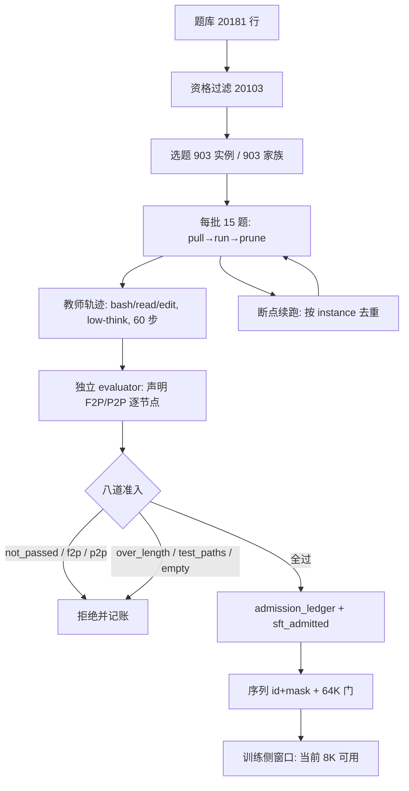

# SWE 数据生产计划总结

日期：2026-10-21。范围：池 A（verified_sft）正式大批量生产。数据源为 `results/pool_a_formal/`，训练侧事实取自 `results/smoke/`。本文只汇总计划与预估，不改动正在运行的编排器。

## 1. 数据需求

### 1.1 要补什么缺口

评测侧现状（SWE-bench 系，Astropy 诊断十题，官方判分）：**3/10 resolved、8/10 有代码补丁、4/10 自然结束**。失败分三类，对应数据需求：

| 缺口 | 现象 | 数据要求 |
|---|---|---|
| 语义修复错 | 交了补丁但改错方向；3/8 交付后正确 | 池 A 必须是**目标测试全过 + 无回归**的完整轨迹 |
| 破坏既有行为 | 两题合计弄红 P2P；非精确过滤导致 1,021 个 P2P 失败 | 准入硬门要求 P2P 声明集合全过 |
| 不交付 / 不验证 | 零代码补丁、只在最后一步改一次、改完不跑测试 | 轨迹形态门 + 至少一次测试执行 |

### 1.2 单条样本形态

一条 = 公开 issue + 仓库快照 → `bash`/`read`/`edit` 原生工具调用轨迹（reasoning 保留）→ 补丁 → 容器内测试收据。

- 工具面与 DSH 评测端逐字对齐：`bash(command, description)`、`read(file_path, offset, limit≤2000)`、`edit(file_path, old_string, new_string, replace_all)`，**无 finish 工具**，自然停止；
- 教师：`deepseek-flash`，`reasoning_effort=low`，回放 reasoning，60 步上限，并发 6；
- 判分：工厂独立 evaluator，F2P/P2P 按数据集**声明集合**逐节点关联，不用 pytest 总数代替。

### 1.3 八道准入（缺一即弃）

| 门 | 判定 |
|---|---|
| 判分通过 | evaluator accepted |
| F2P 完整 | 声明 FAIL_TO_PASS 全过 |
| P2P 完整 | 声明 PASS_TO_PASS 全过 |
| 长度门 | 序列 ≤65,536（当前用户设定） |
| 测试路径 | 补丁未改测试/夹具/快照 |
| 有测试执行 | 轨迹里至少一次测试运行 |
| 非空补丁 | ≥1 个代码 hunk |
| 去重 | 同家族 ≤1 题；题面近重复排除 |

### 1.4 硬约束

- 家族隔离：903 个实例覆盖 903 个家族，验证家族每 6 取 1 排除，避免同仓多题互相泄题；
- 不许用 SWE-bench Verified 正式集训练（评测集另行隔离）；
- 补丁与轨迹中的测试改动一律不采信，判分前恢复测试文件。

### 1.5 池 B（correction_sft）：制造目的与原理

**目的**：池 A 只教"一次做对"，而实际评测里的失败往往不是不会做，而是**做错方向后没有从反馈中掉头**——诊断十题里 13398 用 `FutureWarning` 保留旧行为、13977 用过宽捕获弄红 45 个回归、14182 只透传参数而没有端到端修好。池 B 补的正是"看到证据 → 改方向"这一环。

**原理**：纠错样本必须来自**同一段真实上下文**，而不是把两次独立运行拼在一起。

| 要求 | 原因 |
|---|---|
| 失败证据必须来自教师在工具环境里**真实看到**的输出（pytest 尾巴、断言消息、traceback） | 训练时学生只能看到同类观察；用隐藏判分结果或人工编写的报错冒充观察，会教它错误的条件分布 |
| 前段（错误实现 + 失败观察）标 `loss=0`，只监督修正段 | 否则等于训练模型写出那个错误 |
| 修正段之后必须有真实通过收据 | 否则无法确认"改对了"，只证明"改了" |
| 一次运行内连续发生 | 断裂的两次采样之间没有因果，学生学不到"因为看到 X 所以改成 Y" |

**为什么独立重试不能拼接**：工厂的 `max_retries` 只在任务抛异常时重试，正常判分失败会直接返回。两次独立 run 之间，第二次的教师**从未见过**第一次的失败输出，二者之间不存在"依据反馈修正"的因果链；拼起来只是一个前后矛盾的样本，前段和后段可能基于不同假设。同理，"旧失败 run + 新成功 run"也不能直接配成纠正对。

**可行形态**：同一条轨迹里截取"工具反馈暴露错误 → 教师改方向 → 重跑测试通过"的连续片段；三种原型是 ① 跑套件发现回归后收窄改动、② 端到端验证失败后补全实现、③ issue 有歧义时依据真实行为修正语义。**当前状态：配对导出尚未实现**，所以池 B 条数在本轮计为 0，不进入任何规模与 token 估算。

### 1.6 池 C（行为纪律）：制造目的与原理

**目的**：SWE 诊断十题里 8/10 有补丁但只有 4/10 自然结束，两题是"只分析不动手"的零代码补丁（13579、14096 花掉 5.6 万与 10.6 万输出 token 仍未改文件）。池 C 补的是**过程纪律**：什么时候该动手、什么时候该停、解不出来时怎么诚实收尾。

**原理**：池 C 不新增采集，**从既有轨迹里按规则筛**，因此增量成本接近零，只花判分与统计。

| 子类 | 判定规则 | 目的 |
|---|---|---|
| 落地样本 | 前 N 步内出现文件修改（分析 ≤3 步） | 反"只说不做" |
| 及时停样本 | 测试通过 + diff 非空后尽快自然结束 | 反"通过后继续乱改" |
| 诚实失败样本 | 不可解时以空补丁或明确说明收尾，不伪造改动 | 反"为交差乱改" |

**计数口径**：诚实失败与验证成功**必须分桶**，不能对诚实失败套"全门通过 + 非空补丁"的池 A 标准——否则要么把诚实失败判成坏样本，要么为了凑数把失败伪装成成功。池 C 的准入只看过程属性（首个 edit 位置、测试与结束的先后、补丁是否为空），不要求 F2P 全过。

**当前状态**：筛选规则已定，尚未跑成独立导出批次；同样不计入本轮规模与 token。

### 1.7 三池配比与 B 延迟时的处理

目标配比仍是 A 50–60% / B 25–30% / C 15–20%，但这是**存量配比**，不是本轮必须凑满的配额：

| 情形 | 处理 |
|---|---|
| B 按计划可用 | 按目标配比混比，B 只取真实连续修正片段 |
| **B 延期（当前状态）** | pilot 配比**临时偏向 A + C**，B 记 0 并在报告中注明；**不伪造 B** |
| C 增量筛选完成 | C 只从已有 A 轨迹与其失败轨迹筛，不额外调教师 |

宁可让 pilot 出现"B 缺位"，也不要给出拼接出来的假纠错对：前者只是配比偏离，后者会把"无因果的改判"教进模型，而且很难在后续训练里纠正。

## 2. 数据规模

> 口径说明：本节与 §3 的全部数量、token 只覆盖**池 A**。池 B 尚未实现配对导出、池 C 尚未跑成独立批次，故均计 0，不摊进任何分母。

### 2.1 计划总量与实际完成

| 阶段 | 数量 |
|---|---:|
| 题库原始行 | 20,181 |
| 过滤后可选题 | 20,103 |
| 本轮选题（每家族 ≤1） | **903** |
| 已尝试 | 471 |
| 已准入 | **237** |
| 剩余未跑 | 432 |
| 完成度 | 471/903 = **52.2%** |

### 2.2 转化漏斗（按已尝试 471 计）

| 阶段 | 数量 | 占已尝试 |
|---|---:|---:|
| 判分通过 | 286 | 60.7% |
| 过八门准入 | **237** | **50.3%** |

拒绝原因（按次数，一题可多因）：

| 原因 | 次数 |
|---|---:|
| not_passed | 181 |
| f2p_incomplete | 172 |
| over_length | 34 |
| p2p_incomplete | 21 |
| test_paths_edited | 20 |
| no_test_at_all | 12 |
| empty_patch | 6 |
| duplicate_patch | 5 |
| infra_error | 4 |

### 2.3 规模推算

按 50.3% 准入率外推：

| 目标池 A 条数 | 需尝试题数 | 是否有可用题库 |
|---|---:|---|
| 300 | ~600 | 903 内可满足 |
| **454（903 全跑完）** | 903 | 当前计划终点 |
| 500 | ~1,000 | 需二次选题（题库还有 19,200 行） |
| 800 | ~1,600 | 需二次选题 + 更长采集周期 |

当前 903 题全部跑完的终点是 **约 454 条**。若要 500–800 条，必须再做一轮选题与资格验证（题库余量充足，瓶颈在镜像拉取吞吐与墙钟）。

### 2.4 墙钟与吞吐

- 单批 15 题需 330–1300 秒，其中镜像拉取占主导；8 路并行无法线性压缩；
- 903 题预计 **15–20 小时**，跨轮次续跑属设计内行为；
- 已完成 471 题实际耗时约 13 小时（2026-10-21 04:18 起）。

## 3. 预估 token

> 同 §2：以下数字是池 A 口径。池 C 从既有轨迹筛选，增量 token 约等于 0（不重新调教师）；池 B 在导出实现前不计 token。

### 3.1 已产样本实测分布（237 条，按学生模板渲染）

| 指标 | 值 |
|---|---:|
| 序列 token 合计 | **5,366,370** |
| 监督 token 合计 | **1,727,019**（32.18%） |
| 每样本均值 | 22,642.9 |
| 监督均值 | 7,287.0 |
| 最短 / p50 / p90 / 最长 | 3,253 / **17,274** / 46,635 / 65,478 |
| 监督 p50 | 5,181 |

长度分档（决定可训性，见 §4）：

| 窗口 | 条数 | 占比 |
|---|---:|---:|
| ≤8K | 49 | 20.7% |
| ≤16K | 111 | 46.8% |
| ≤32K | 181 | 76.4% |
| ≤64K | 237 | 100% |

### 3.2 规模外推（按当前均值）

| 目标条数 | 总 token | 其中监督 token |
|---|---:|---:|
| 237（已完成） | 5.37M | 1.73M |
| 300 | 6.79M | 2.19M |
| **454（903 终点）** | **10.28M** | **3.31M** |
| 500 | 11.32M | 3.64M |
| 800 | 18.11M | 5.83M |

### 3.3 教师侧成本（已花费，471 题）

| 项 | 值 |
|---|---:|
| 累计 prompt token | 345.33M |
| 累计 completion token | 5.87M |
| 每题 prompt 均值 / p50 | 733,178 / 325,654 |
| 每题 completion 均值 / p50 | 12,466 / 9,282 |
| 每条准入摊到的 completion | 约 24.8k |

外推：跑完 903 题约需 **660M prompt、11.2M completion**；做 800 条则约 **1.2B prompt、20M completion**。prompt 占绝对大头，原因是多轮轨迹每步重复携带上下文。

## 4. 关键风险：产量与训练窗口不匹配

smoke 实测（RTX 5090 D 31.8 GiB，bf16 + LoRA r32 + 梯度检查点 + 分块 CE）：

| 序列长度 | 结果 |
|---|---|
| 8K | **26.35 GiB，1,948 tok/s，可用** |
| 16K | OOM（单笔 16 GiB 请求） |
| 32K | OOM（单笔 64 GiB 请求） |

请求随长度平方增长，且与注意力后端无关（强制 `mem_efficient` 后不变），定位在线性注意力路径的 `L×L` 中间量。

**后果：当前 237 条里只有 49 条（20.7%）能按 8K 窗口直接训练；p50 = 17,274 的样本需要 16K+ 才能用。**

两条路：

1. **修窗口**：在 WSL2/Linux 重跑同一 smoke（fla/flash 官方支持更完整），或对 `Qwen3_5GatedDeltaNet` 的 chunk 维度打补丁。修好后 181 条（≤32K）基本可用。
2. **改产出形状**：压低 `max_steps` 到约 25、或导出时压缩 loss=0 的旧工具观察，把 p50 压进 8K。

在窗口结论出来前继续全速跑剩余 432 题，会再产出一批大概率超出可训长度的样本，但不会浪费——它们仍是有效的判分与失败模式证据，只是训练可用比例低。

## 5. 生产流程

## 6. 结论与下一步

1. **需求明确**：池 A 只需"全门通过 + 至少一次真实测试"的完整轨迹；池 B 补"看到真实失败反馈后改方向"，池 C 补"何时动手、何时停、解不出时怎么诚实收尾"。
2. **规模**：池 A 当前 237/903 完成度 52.2%，准入率 50.3%，903 跑完预期 **454 条**；要 500–800 条需二次选题。池 B 与池 C 本轮计 0。
3. **token**：池 A 237 条已产 5.37M（监督 1.73M）；454 条预计 10.28M（监督 3.31M）；800 条约 18.1M（监督 5.8M）。池 C 增量成本≈0，池 B 未计。
4. **B/C 现状**：池 B 的同轨迹配对导出**尚未实现**（独立重试不能拼接、隐藏判分不能伪装成工具观察），池 C 的筛选规则已定但未跑成批次。
5. **配比策略**：B 延期期间 pilot 临时偏向 A + C，并在报告中明确标注 B=0；**不伪造 B**。
6. **最大不确定性不是产量而是训练窗口**：8K 可用、16K+ 被平方级分配阻塞。建议先定窗口结论，再决定是否压缩轨迹长度或继续全速采集。

## 7. 证据

- [池A正式生成数据分析报告](2026-10-21-池A正式生成数据分析报告.md)
- [smoke 与大批量启动纪要](2026-10-21-smoke与大批量启动纪要.md)
- `results/pool_a_formal/export_summary.json`、`admission_ledger.jsonl`、`sft_admitted.jsonl`
- `results/smoke/summary.json`、`summary_v2.json`
