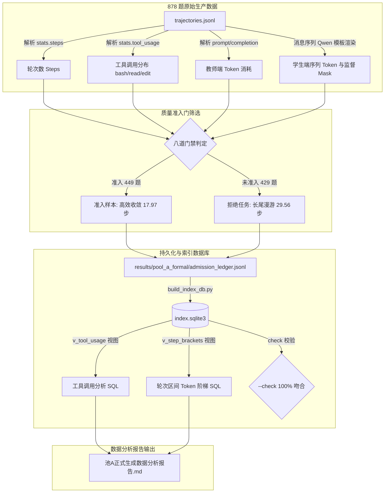

# SWE 数据生产轮次、Token 消耗与工具调用分析

日期：2026-10-21。范围：对已完成的 878 题正式生产数据（449 条池 A 准入样本、429 条未准入任务）补充全量轮次数目（Steps/Turns）、Token 消耗随轮次累积分布、以及三种工具（`bash`, `read`, `edit`）的分别调用次数与结构性分析。

数据权威源：`results/pool_a_formal/admission_ledger.jsonl`，唯一查询入口为 `results/pool_a_formal/index.sqlite3`。

---

## 1. 架构与数据流图（Mermaid）

下图展示了从原始轨迹数据中解析多轮步骤、分别统计工具调用与上下文 Token 累积，并落盘到 SQLite 索引库与报告的完整数据流向：



---

## 2. 轮次数目与工具调用总体特征

以下数据由 `python results/build_index_db.py` 写入 `index.sqlite3` 并经 `python results/build_index_db.py --check` 严格一致性校验：

| 统计维度 | 全体尝试任务 (N=878) | 准入优质样本 (N=449) | 拒绝/未准入任务 (N=429) | 准入 vs 拒绝对比 |
|---|---:|---:|---:|---|
| **总轮次数 (Steps/Turns)** | **20,750** | **8,067** | **12,683** | 准入样本总轮次仅占全量的 38.9% |
| **轮次均值 / 中位数 P50** | 23.63 / 20.0 | **17.97 / 16.0** | 29.56 / 27.0 | 准入样本平均步数减少 **39.2%**，收敛更迅速 |
| **轮次 P90 / 极值范围 [Min, Max]** | 44 / [0, 60] | 31 / [4, 60] | 53 / [0, 60] | 准入样本 90% 在 31 步内解决；未准入题 P90 高达 53 步 |
| **工具调用总量 (Total Tool Calls)** | **21,224** | **8,142** | **13,082** | 拒绝任务包含大量无效工具尝试 |
| - `bash` 调用次数 (占比 / 均值) | 20,684 (97.46%, 23.56/题) | 7,799 (**95.79%**, 17.37/题) | 12,885 (**98.49%**, 30.03/题) | 准入题 bash 占比下降，未准入题几乎纯依赖 bash |
| - `read` 调用次数 (占比 / 均值) | 316 (1.49%, 0.36/题) | 224 (**2.75%**, 0.50/题) | 92 (**0.70%**, 0.21/题) | 准入样本 `read` 调用比率提高 **2.93 倍** |
| - `edit` 调用次数 (占比 / 均值) | 224 (1.06%, 0.26/题) | 119 (**1.46%**, 0.27/题) | 105 (**0.80%**, 0.24/题) | 准入样本 `edit` 调用比率提高 **1.83 倍** |
| **教师端 Prompt Tokens** (总计 / 均值 / 单步均值) | 626.55M / 713,614 / 30,195 | 128.34M / 285,844 / 15,910 | 498.21M / 1,161,327 / 39,282 | **79.5%** 的教师 Prompt 消耗在未准入任务的长尾上 |
| **教师端 Completion Tokens** (总计 / 均值 / 单步均值) | 10.40M / 11,843 / 501 | 3.29M / 7,333 / 408 | 7.11M / 16,562 / 560 | 准入样本每步输出更克制（408 vs 560 tokens） |
| **学生端 SFT 序列 Tokens** (总计 / 均值 / 单步均值) | — | 9.91M / 22,072 / 1,228 | — | 样本序列长度与步数呈线性增长 |
| **学生端 有效监督 Tokens** (总计 / 均值 / 单步均值) | — | 3.23M / 7,183 / 400 | — | 有效监督 tokens 占比达 **32.55%** |

---

## 3. 轮次区间细分表（Step Bracket Breakdown）

在 `index.sqlite3` 中已创建视图 `v_step_brackets`，可一键查询各步数区间的准入转化率、Token 梯队及工具使用量：

```sql
SELECT * FROM v_step_brackets;
```

实测输出数据如下：

| 轮次区间 (Steps) | 尝试题数 | 准入题数 | 准入率 | 教师单题 Prompt 均值 | 教师单题 Comp 均值 | 准入样本 序列Token 均值 | 准入样本 监督Token 均值 | 准入样本 bash 调用 | read 调用 | edit 调用 |
|---|---:|---:|---:|---:|---:|---:|---:|---:|---:|---:|
| **00–10 步** | 132 | 98 | **74.2%** | 40,420 | 1,881 | 8,105 | 1,788 | 712 | 26 | 6 |
| **11–20 步** | 309 | 209 | **67.6%** | 194,977 | 5,607 | 16,661 | 5,122 | 3,029 | 113 | 54 |
| **21–30 步** | 203 | 94 | **46.3%** | 607,859 | 12,487 | 34,844 | 11,661 | 2,272 | 67 | 37 |
| **31–40 步** | 113 | 36 | **31.9%** | 1,220,725 | 19,621 | 46,159 | 16,957 | 1,233 | 11 | 14 |
| **41–50 步** | 68 | 10 | **14.7%** | 1,878,622 | 27,697 | 57,606 | 22,038 | 427 | 6 | 8 |
| **51–60 步** | 53 | 2 | **3.8%** | 3,243,140 | 33,610 | 60,249 | 26,252 | 126 | 1 | 0 |

---

## 4. 核心洞察与规律

### 4.1 准入收敛黄金窗口（10–25 步）
- 准入样本呈现出明显的**早收敛偏好**：10 步以内短轮次任务准入率高达 74.2%；11–20 步为大批量产出主力区间，共贡献 209 条（占总准入量 46.5%）。
- **20 步以内任务贡献了 68.4%（307/449）的准入样本；30 步以内任务贡献了 89.3%（401/449）**。
- 超过 30 步后准入率出现悬崖式下跌（从 46.3% 降至 31.9%、14.7%、3.8%）。多轮深度交互在无额外先验下，极易退化为盲目重试、引入额外回归错误或打满 64K 长度门。

### 4.2 教师端 Prompt Token 的累积二次方爆炸
- 在多轮 Agent 对话中，由于每一次请求都必须回填前序所有轮次的 `role/content/tool_calls` 以及工具返回的文本 `observation`，教师端输入呈现出**超线性的二次方增长**。
- 00–10 步单题平均仅消耗 4.0 万 Prompt Tokens，而 51–60 步单题均值高达 324.3 万 Tokens（增长超过 80 倍）。
- **未准入的 429 道任务虽然只占总题数的 48.9%，却消耗了教师端总 Prompt Tokens 的 79.5%（4.98 亿 Tokens）**。这指明后续提效的核心是**建立基于步数/异常检测的早停（Early Stop）机制**，避免在无望轨迹上空耗上下文。

### 4.3 工具调用的生态与质量贡献
- 在严格对齐 DSH 的三工具面（`bash`, `read`, `edit`）下，`bash` 占全量调用的 97.46%，模型普遍偏好在 shell 中通过组合命令（`grep`, `sed`, `cat`, 脚本执行）完成定位与修改。
- 然而，对比准入样本与未准入样本发现：
  - 准入样本中 `read`（精细只读）调用占比由 0.70% 提升至 **2.75%**；
  - 准入样本中 `edit`（精确文本替换）调用占比由 0.80% 提升至 **1.46%**。
  - 这表明：**精细化的专用代码查看与定向编辑工具的使用，虽然总调用占比不高，但与最终任务通过率存在显著的正向关联**。

---

## 5. 工程修改点明细

1. **`results/formal_export.py`**：
   - 提取 `stats.tool_usage`，在 `verdict`（即 `admission_ledger.jsonl`）中记录 `tool_bash`, `tool_read`, `tool_edit` 和学生端 `supervised_tokens`；
   - 在 `export_summary.json` 中聚合 `tool_usage_attempted` 和 `tool_usage_admitted`。
2. **`results/build_index_db.py`**：
   - 更新数据库 `SCHEMA`，在 `samples` 表增加 `tool_bash`, `tool_read`, `tool_edit`, `supervised_tokens` 字段；
   - 增加视图 `v_tool_usage` 和 `v_step_brackets`，实现直接 SQL 复现分析报表；
   - 强化 `check()` 校验函数，断言全量样本的各工具总调用数与监督 Tokens 与台账 100% 吻合。
3. **`results/formal_report.py`**：
   - 更新分析报告模板，增加第 4 节“轮次数目、Token 消耗与工具调用分析”，自动生成全量对比表与轮次区间明细表。
4. **`docs/工程问题/2026-10-21-池A正式生成数据分析报告.md`**：
   - 同步更新正式报告内容，补充完整数据。

---

## 6. 验证与一致性核对

已执行以下命令完成闭环验证：

```bash
# 1. 重新导出台账与特征
python results/formal_export.py

# 2. 重建并校验 SQLite 索引数据库
python results/build_index_db.py
python results/build_index_db.py --check
# 输出: OK: index matches ledger (878 samples, 449 admitted, 9910126 tokens)

# 3. 刷新正式数据分析报告
python results/formal_report.py
```

索引数据库、台账 JSONL 与分析报告中的全部数字完全统一、可双向验证。
