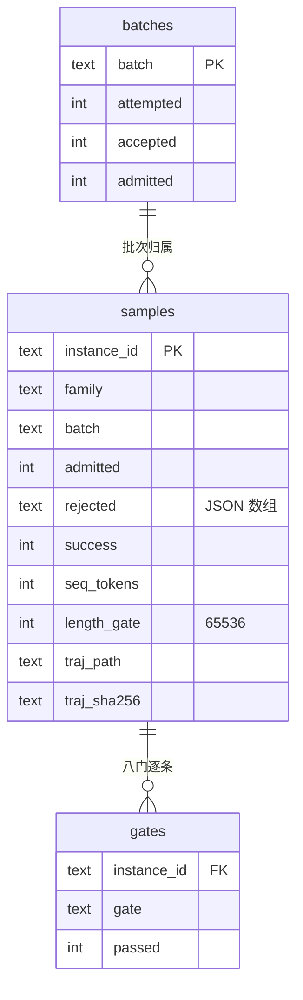

# SWE 数据索引库与工程总结

日期：2026-10-21。范围：池 A 正式批量的**索引库建设**与当前工程状态总结。数据源 `results/pool_a_formal/`，快照时点 **2026-10-21 18:00**。

## 1. 结论

- 已建立 `results/pool_a_formal/index.sqlite3`（1.5 MB），只存**索引与台账**，轨迹与 ids+mask 仍在磁盘，按路径与 sha256 引用；
- 建库后逐项校验与源 JSONL 完全一致：878 样本、449 准入、9,910,126 序列 token、7,902 条门记录、拒绝原因分布逐键相同、878 条轨迹全部可定位、无重复 instance；
- 生产**已暂停**在 878/903（97.2%），不是"正在跑"；准入率 **51.1%**（449/878）；
- 池 B / 池 C 仍计 0（B 配对导出未实现、C 未跑成批次），未摊进任何分母。

## 2. 为什么建这个库

之前完全靠脚本扫文件，这两天实际撞到的问题：

| 痛点 | 具体表现 |
|---|---|
| 每次导出全量重扫 | `formal_export.py` 要遍历 60 个批次目录重算准入 |
| 断点续跑靠 glob 约定 | 曾因 glob 少一层目录导致已完成题被重跑，白花教师预算 |
| 跨批统计现算 | p50、长度分档、拒绝分布每次重新解析数 GB JSONL |
| 无唯一性约束 | 同一 instance 多批次出现只能靠脚本约定去重 |
| 审计链分散 | 判定、成本、证据散在多个 jsonl，追溯单条要跨文件拼 |

按项目约定（需要索引/持久化时用 SQLite 而不是自造结构），把这些查询下沉到库里。

## 3. 库结构



- `samples`：一行一题，含准入判定、八门拒绝列表、F2P/P2P 计数、节点证据类型、长度、步数、教师成本、轨迹路径与哈希；
- `gates`：878 × 9 = **7,902** 行，八门 + `not_passed` 逐条状态，便于 `GROUP BY gate` 统计；
- `batches`：批级汇总；
- 视图 `v_reject_reasons`：拒绝原因排行；
- 视图 `v_needs_rerun`：未准入且非 infra 的题（当前 **425** 条），续跑直接查它。

构建脚本：[build_index_db.py](results/build_index_db.py)。**幂等重建**：每次 DROP 后从台账重新灌入，所以库不会与文件漂移；数据库本身被 `results/` 规则忽略，不入库。

## 4. 校验结果

| 检查 | 库 | 源 | 结果 |
|---|---:|---:|---|
| 样本数 | 878 | 878 | ✅ |
| 准入数 | 449 | 449 | ✅ |
| 门记录 | 7,902 | 878×9 | ✅ |
| 准入序列 token | 9,910,126 | 9,910,126 | ✅ |
| 拒绝分布 | 逐键相同 | — | ✅ |
| 轨迹可定位 | 878 | 878 | ✅ |
| 重复 instance | 0 | 0 | ✅ |

## 5. 当前数据状态

| 指标 | 值 |
|---|---:|
| 选题总数 | 903 |
| 已尝试 | 878（97.2%） |
| 已准入 | **449** |
| 准入率 | 51.1% |
| 准入序列 token 合计 | **9,910,126** |
| 待重跑（非 infra） | 425 |

长度分档（准入样本）：

| 窗口 | 条数 |
|---|---:|
| ≤8K | 89 |
| ≤16K | 211 |
| ≤32K | 353 |
| ≤64K | 449 |

拒绝原因（次数）：`not_passed 342`、`f2p_incomplete 328`、`over_length 56`、`test_paths_edited 43`、`p2p_incomplete 35`、`no_test_at_all 18`、`empty_patch 6`、`duplicate_patch 5`、`infra_error 4`。

**口径提醒**：`sft_admitted.jsonl` 上一次导出停在 237 条（5.37M token、监督 1.73M），237→449 的新增尚未重新导出。因此本文的 9.91M 是台账 `length` 字段合计，与"已渲染 ids+mask"的口径不同；监督 token 需重跑导出确认（若按上次 32.18% 比例粗估约 3.19M，待核）。

## 6. 查询示例

```sql
-- 哪些题该重跑
SELECT instance_id, family, rejected FROM v_needs_rerun LIMIT 20;

-- 拒绝原因排行
SELECT * FROM v_reject_reasons;

-- 按家族统计（当前每家族 1 题，验证隔离）
SELECT family, COUNT(*) FROM samples GROUP BY family HAVING COUNT(*) > 1;

-- 长样本占比
SELECT SUM(seq_tokens > 32768) * 1.0 / COUNT(*) FROM samples WHERE admitted = 1;

-- 成本前 10
SELECT instance_id, prompt_tokens, completion_tokens
FROM samples ORDER BY prompt_tokens DESC LIMIT 10;
```

## 7. 边界与限制

1. **派生库，不是主存储**：`admission_ledger.jsonl` 才是权威源；库随时可重建，改动台账后需重跑建库；
2. **不双写**：轨迹、ids+mask、报告不入库，避免文件与库不一致；
3. **快照性**：生产恢复后库会落后，需在每轮导出后重建；
4. **并发**：当前单写者、批次串行，SQLite 够用；若将来多编排器并行，需 WAL 或换服务型数据库；
5. **字段随门禁演化**：本轮"验证门"已降级为台账字段（`verified_after_last_edit`），后续改门前需先改 schema。

## 8. 工程状态总结

| 线 | 状态 |
|---|---|
| 数据生产（池 A） | 暂停在 878/903、449 准入；编排器支持幂等续跑 |
| 索引库 | 已建并校验；重跑一条命令重建 |
| 池 B（纠错） | 未实现配对导出；**不伪造** |
| 池 C（行为） | 筛选规则已定，未跑成批次；增量成本≈0 |
| 训练窗口 | **8K 可训**（26.35 GiB）；16K/32K 因平方级分配 OOM |
| 口径一致性 | 449 条中 ≤8K 仅 89 条，即多数已产样本当前无法直接训练 |

最大的未解问题仍是**窗口与样本长度的错配**：库里 449 条准入样本 p50 远超 8K。索引库让这个问题可以直接用一条 SQL 量化，但解决它需要修训练栈（WSL2 重跑 smoke / 给线性注意力 chunk 打补丁），而不是继续加大采集。
