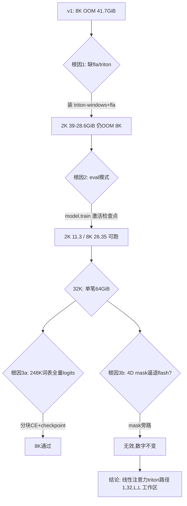

# smoke 与大批量启动纪要

日期：2026-10-21 03:30–03:55。范围：LoRA 显存 smoke（多轮迭代）与正式大批量生成启动；数据线与训练线独立推进。

## 1. 训练环境（从零搭建）

本机原无任何训练栈。新建 `E:\Deeplearning\local_train\.venv`（Python 3.12）：

| 组件 | 版本 | 说明 |
|---|---|---|
| torch | 2.11.0+cu128 | RTX 5090 D（32,607 MiB，驱动 CUDA 13.4）|
| transformers | 5.20.2 | `Qwen3_5ForCausalLM`，hybrid 架构原生支持 |
| peft | 0.21.2 | LoRA r32/alpha64，trainable 42.5M（1.00%）|
| triton-windows | 3.8.0 | fla 内核 JIT 前置条件 |
| flash-linear-attention | 最新 | 线性注意力 triton 内核 |

架构事实（`model/config.json`）：32 层中 **24 层 linear_attention**（每 4 层 1 层 full_attention）、**词表 248,320**、`mamba_ssm_dtype: float32`、MTP 1 层、max_position 262,144。

## 2. smoke 迭代：三次根因三次修复

| 阶段 | 2K | 8K | 32K | 关键改动 |
|---|---|---|---|---|
| v1（基线栈） | OOM* | OOM | OOM | 无 fla、eval 模式、全量 logits |
| +fla/triton | 28.66 GiB / 115 tok/s | OOM | OOM | 参考核→triton 内核 |
| +train() | **11.30 GiB / 2,395 tok/s** | 26.35 / 1,281 | OOM(64GiB 单笔) | 梯度检查点生效 |
| +分块CE | — | **26.35 GiB / 1,948 tok/s** | 同上 | 词表 chunk=1024+checkpoint |
| +mask旁路 | — | 26.35（不变） | 同上 | 排除 mask 假设 |

*v1 的 2K 曾报 38.99 GiB"分配"（超过物理 31.82）——WDDM 显存溢写系统内存的特征。

**独立验证**：SDPA 本体（head_dim 256、bf16、causal、带梯度、32K）峰值仅 **2.53 GiB**，flash 后端可用——32K 阻塞与全注意力无关。

### 2.1 当前判定

- **可用窗口：≤8K**（26.35 GiB，留 5.5 GiB 余量）
- **32K/64K 阻塞**：线性注意力 triton 路径存在 `[1, 32, L, L]` 形状的 64GiB 单笔分配（32K 时）。`flex_attention` 该架构未接线（加载即报 ValueError）
- **数据导出 64K 门维持不变**（用户设定）；仅训练窗口受限

### 2.2 后续可选路径（未执行）

1. 升级/降级 fla 版本找 chunked-backward 变体；
2. 编译 `causal-conv1d`（Windows 需 nvcc，重）；
3. WSL2 + Linux 轮子（flash-attn/fla 官方支持）；
4. 对 GatedDeltaNet 做 query 分块补丁（工程量大，正确性需对拍）。

## 3. 数据线：正式大批量已启动

- **审计**（`results/audit_select.py`）：20,181 行 → 过滤后 20,103 可选；排除已用 77 题、题面近重复；**选出 903 实例、覆盖 903 个不同家族**（轮询制，每家族 ≤1）；验证家族每 6 取 1 隔离
- **镜像约束**：Docker vhdx 在 **C: 仅剩 50.3 GB**（已 327.2 GB），均值 2.4 GB/张 → **每批 15 张**滚动 pull→run→prune；88 张既有镜像保护不动
- **编排器**（`results/run_formal_batches.py`）：断点续跑（按 results.jsonl 去重）、拉取失败题单列跳过、每批记账 `batch_ledger.jsonl`、跑完即删本批拉取的镜像
- **配置不变**：deepseek-flash low、60 步、并发 6、原契约、独立判分
- 903 题 × ~15–20 分钟/批（60 批）≈ **15–20 小时**，跨轮次续跑

## 4. 交付物状态

| 项 | 状态 |
|---|---|
| smoke 脚本（v1/v2/debug/probe） | 已落盘 `results/` |
| 训练 venv | `E:\Deeplearning\local_train\.venv` |
| 审计选题 | `results/pool_a_formal/tasks_formal.jsonl`（903）+ `qualification.json` |
| 大批量编排 | 运行中，`results/pool_a_formal/batch_*/` |
| 数据分析报告 | 待全部批次完成后出具 |

## 5. 首批实测（batch_001）与导出管线

| 指标 | 值 |
|---|---:|
| 题目 | 15 |
| 判分通过 | 8（53.3%） |
| 耗时 | 407 s（并发 6） |
| 过八门后准入 | **7** |
| 序列 token | 128,169 |
| 监督 token | 46,141（36.0%） |
| 每样本 | 18,310 |

首批暴露并修掉三个判定错误，均已写入脚本注释：

1. **成功记录没有逐节点 statuses**：工厂只在失败路径输出 `matched`，成功只留 `marker=pytest_true`。原实现把"未匹配"误判成失败，导致 8 条通过全被拒；改为成功按 evaluator 接受推定并标注 `node_evidence=evaluator_acceptance`。
2. **验证门只认 `edit` 工具 + `pytest`**：flatbuffers 这类题用 `python3 - <<PY` 写文件、`ctest` 跑测试，被误判 `no_test_after_edit`。
3. **命令级检测不可靠**：放宽后仍把 10/15 判成未验证。最终把"最后一次修改后是否验证"降级为台账统计字段，硬门只要求"轨迹里至少执行过一次测试"——因为 evaluator 已证明补丁通过全部声明测试。

镜像清理改为**白名单**：只保留编排器启动前已存在的镜像，其余按批清除；`rmi` 失败先 `docker container prune -f` 再删。已完成的 15 题由 `done_ids()` 正确跳过（修复了 glob 少一层目录的 bug，否则会重复消耗教师预算）。

## 6. 32K/64K 阻塞的进一步定位（2026-10-21 06:00）

| 长度 | 结果 |
|---|---|
| 8K | 26.35 GiB，1,948 tok/s（可用） |
| 16K | OOM，单笔请求 **16 GiB** |
| 32K | OOM，单笔请求 **64 GiB** |

请求随长度**平方增长**，精确对应 `heads × L² × 2/4 bytes`：16K 时 16 GiB、32K 时 64 GiB。

隔离实验：

| 假设 | 实验 | 结果 |
|---|---|---|
| 缺 fla 内核 | 装 triton-windows + flash-linear-attention | 2K 39→11.3 GiB，但 16K 仍 OOM |
| 线性注意力内核工作区 | `--fla off` 强制参考实现（chunk=64） | **不变**，仍 16 GiB |
| 4D 因果 mask 逼退 flash | 旁路 `create_causal_mask` | **不变** |
| eager 注意力 | 计数器统计调用 | `eager` 0 次、`sdpa` 被调用——不是 eager |
| SDPA 后端能力 | 强制各后端单独测 | **flash/cudnn 均报 "No available kernel"**（head_dim=256），**mem_efficient 可用且仅 1.40 GiB** |
| 强制 mem_efficient | `--sdpa-backend mem_efficient` | **仍 16 GiB** —— 分配来自另一条路径 |

**结论**：8K 是当前 Windows 栈实测可训窗口；16K+ 被一个与注意力后端选择无关的平方级分配阻塞（形状匹配 32 个线性注意力 value head 或 16 个全注意力 head 的 L×L 中间量）。可用后端里只有 mem_efficient 支持 head_dim=256。

**建议后续**：① 在 WSL2/Linux 上重跑同一 smoke（Linux 轮子对 fla/flash 支持更完整）；② 或对 `Qwen3_5GatedDeltaNet` 的 chunk 维度做补丁并逐层对比数值；③ 数据侧 64K 门按用户设定不变，训练侧先按 8K 起步。
