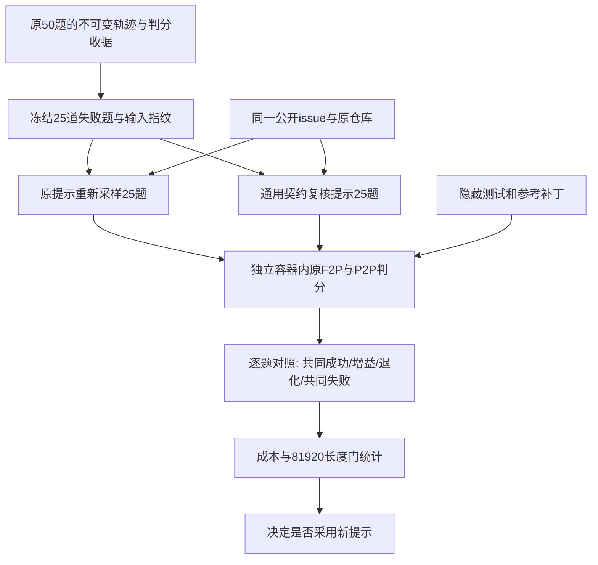

# 公开契约复核与失败题对照复测

日期：2026-10-21。状态：两臂复测和导出已完成；本版通用契约提示未观察到提效，维持默认关闭。

本次工作用于核验“完善契约是否能提高原失败题的修复成功率”。旧的逐题 FAILED 行属于失败现象，不能直接证明根因是隐藏接口不可推断。

隐藏评测材料仅用于工厂原有判分流程，不构造教师提示或每题修复线索；不会把上轮判分失败的节点名、断言或补丁接到新轨迹中。

## 修改内容

- [contract_review.py](<aweagent/scaffold/dsh_compat/contract_review.py>)：新增 task-independent `public-contract-v1`。要求从 issue 识别明确的名称、位置、签名、默认值、空值/异常和副作用；检查现有调用点；做由公开需求导出的直接检查；结束前复核 diff 和最后一次修改后的验证结果。保持简短思考、及时动手。
- [agent.py](<aweagent/scaffold/dsh_compat/agent.py>)：新增默认关闭的 `contract_review`。由已有 `extra.dsh_contract_review` 读取。关闭时提示逐字等于旧版；启用时只附加通用提示，三个工具 schema、自然结束、测试恢复与判分逻辑均不变。
- [contract_experiment.py](<recipes/scale_swe/contract_experiment.py>)：复用工厂 TaskRunner 和 evaluator。冻结25题及原始收据指纹；分别生成 control/contract 的原生轨迹与结果；拒绝静默覆盖已经启动的 arm；比较F2P、P2P、成本、基础设施错误和逐题得失。
- [test_dsh_contract_review.py](<tests/agent/test_dsh_contract_review.py>)：验证默认行为、工具面、配置开关、隐藏元数据隔离。

## 比较口径

教师沿用 `deepseek-flash`、`reasoning_effort=low`、每次输出8192、60步、并发6、基础设施重试上限3；保留原判分逻辑，导出长度门81920。对照组也重新采样，因旧失败题重试本来就可能成功，不能用“旧0/25→新X/25”证明优化效果。该实验不是同一会话中的纠错示范，不能直接拼成池B成功修正轮。

旧50题的25条失败，按声明测试ID精确关联的基线为：F2P 28/80通过，12题F2P全败；P2P 3278/3282通过，4个回归集中在cookiecutter974。pr1008有完整目标测试失败收据，不按infra剔除。原导出25条的真实模板序列最长78573，32K会拦下8条；原报告79670和9条来自内容分段估算，不能当作长度门的实际结果。

## 验证

六项stdlib unittest通过，额外覆盖Task用户提示的隐藏材料隔离与F2P/P2P分类。尝试运行原有pytest套件时，工厂venv未安装pytest；没有把该检查写成通过，也没有在正在运行的教师实验中变更依赖。首次启动在本地指纹预检处因Windows CRLF/LF差异退出，尚未调用教师；修正为同时验证文件指纹与规范化文本内容后启动两臂。

## 结果

完整逐题结果见[池A五十题与80K窗口](../池A五十题与80K窗口.md)第7节。旧run不覆盖。

| 指标 | 原提示control | 契约提示contract |
|---|---:|---:|
| 题目通过 | 2/25 | 1/25 |
| F2P通过 | 35/80 | 33/80 |
| API输入token | 28280725 | 22486827 |
| API输出token | 484649 | 462585 |
| 每条通过输出成本 | 242324.5 | 462585 |
| 80K内候选 | 2 | 1 |

逐题新增成功是pyedb_pr336，退化是qontract_pr1125/pr931，共同失败22。契约组虽然总输出少4.55%，每条通过输出成本却高90.90%，不启用为默认。原提示重采样同样能恢复失败，因此不能把新提示相对旧0/25的变化归因于优化。

两臂合计50次任务尝试、1665次LLM调用，输入50767552、输出947234；日志无额外实例重试，最终无evaluator error或缺失轨迹。两臂的日志token与保存轨迹stats一致。三条新增候选均通过原判分及同一81920长度门，但未宣称完成全部训练准入验收。

新增汇总入口 [summarize_contract_experiment.py](<recipes/scale_swe/summarize_contract_experiment.py>) 会生成 [analysis_summary.json](<results/contract_retry_v1/analysis_summary.json>) 与25行逐题表；并明确区分只有成功marker的聚合推定和逐节点证据。原始材料集中在 [contract_retry_v1](<results/contract_retry_v1>)。

遗留限制：每题每臂一次、只覆盖旧失败子集、两臂顺序运行，不能推导全库收益。已有file工具的全局/testbed与实例/workspace路径绑定问题会造成有效路径拒绝，本次为控制变量未途中更改；后续应独立修复验证。旧镜像构建元数据还存在版本资格风险，不能把本轮候选直接称作干净训练成品。
