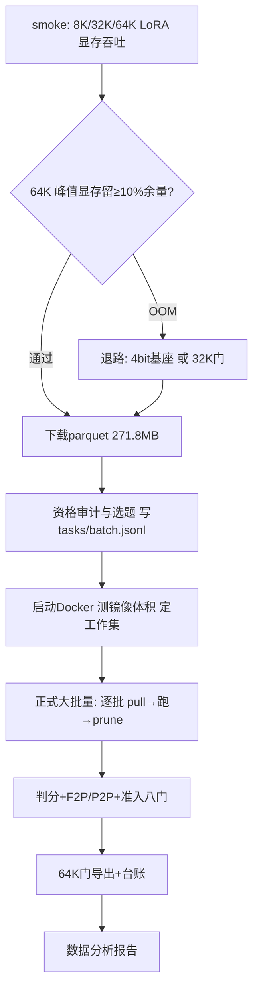

# 原契约 SWE SFT 正式生成方案 v2（增量抓取 · 64K 门 · LoRA）

日期：2026-10-21。修订依据：用户决定 (1) 增量抓取而非整库下载，(2) 窗口门禁 64K，(3) 计划 LoRA 训练，(4) **先跑显存 smoke，通过后跳过 Pilot 直接正式大批量**，(5) 完成后交付数据分析报告。本版**取代 v1**中"81 题硬上限 / 80K 门 / 三波 Pilot"的口径，其余（原契约、教师、工具面、准入门）不变。

> 2026-10-21 03:30 实测补充：GPU 为 RTX 5090 D（32,607 MiB，空闲 30.5 GB），驱动 CUDA 13.4；本机此前**无任何训练栈**（两个 Python 均无 torch），已在 `E:\Deeplearning\local_train\.venv` 新建训练环境（torch cu128 + transformers + peft）。

## 0. 三处事实更正（先于方案）

| v1 说法 | 实测 | 影响 |
|---|---|---|
| "全量下载太耗储存" | `AweAI-Team/Scale-SWE`：**20,181 行**，parquet **271.8 MB**，原始文件 983.7 MB（HF datasets-server `/size`） | 数据集**不占盘**，整库下载不到 1 GB；真正吃存储的是**每题一个 Docker 镜像** |
| 32K 门丢 32% | 64K 门实测 **23/25 = 92%**（仅 2 条在 65.5K–78.6K 之间） | 64K 比 32K 多留 24 个百分点样本，任务需求随之下降 |
| 80K 门 | 64K 后 SWE 单条序列 p50 25.1K、max 78.6K | 64K 下仍需按样本丢弃，不能截断（截断破坏因果） |

本地环境实测：Docker 引擎**当前未运行**（`npipe ... not found`）；`datasets` 缺硬依赖（`huggingface_hub`、`pyarrow` 均未安装），因此抓取走 **`requests` + HF datasets-server REST**（已实测 `huggingface.co` 返回 200，`/splits`、`/size` 均可读）。

## 1. 增量抓取方案

### 1.1 数据行：一次拉全库元数据，按需留行

数据集仅一个 `default/train` split。做法：

1. 下载**全量 parquet（271.8 MB）**到 `data/scaleswe_raw/`——这不是"全量语义"，只是把行元数据本地化，便于反复筛选而不再联网；
2. 本地按规则筛出候选池，**只把选中的行写进 `tasks/<wave>.jsonl`**（每行含 `instance_id/user/repo/parent_commit/image_url/problem_statement/FAIL_TO_PASS/PASS_TO_PASS` 等）；
3. 记录每行的 `instance_id` 与 `repo` 家族，供后续去重与家族级 split。

若 parquet 下载受限，退化为 `/rows?dataset=AweAI-Team/Scale-SWE&config=default&split=train&offset=..&length=100` 分页抓取，逐页筛选落盘，内存常驻不超过一页。

### 1.2 镜像：真正的存储与时间成本，必须按工作集管理

- 每个实例对应 `aweaiteam/scaleswe:<instance_id>`（历史拉取错误中已见该命名）。
- **先测三张镜像的真实体积**（Docker 启动后 `docker images` 统计），再定工作集上限；未测前按 1.5–4 GB/张估计。
- 560.9 GB 剩余空间下，若不清理，约 140–370 张镜像就会触顶；而 Pilot 需要数百实例，**因此必须 pull → 跑 → prune**，常驻镜像控制在 `并发数 × 2`（建议 12 张以内，约 20–50 GB）。
- 拉取与采集交错：Wave 内先批量 pull（4–6 路并行），跑完一批立即 `docker image prune -f` 释放。

### 1.3 资格审计（零教师成本，抓取前完成）

对候选行做静态标注：`contract_ambiguous`（依赖 issue 未给的内部 helper 名）、`known_unsolvable`（需改测试/快照）、`infra_risk`（镜像缺失/离线装不上）、`leak_risk`（构建元数据含未来版本文件）。命中者不入 Wave，台账记录原因。**审计存活率按 85% 估算**（与 v1 同口径，未实测）。

## 2. 64K 门 + LoRA 训练口径

### 2.1 门禁

- 导出长度门 **65,536**（Qwen 模板渲染后 token 数），超门即丢弃并记账，**不截断**；
- mask 与 ids 等长；`<think>` 至少一处非空且在 mask=1；工具 schema 进模板；
- 其余准入八门不变（真实判分、不碰测试、编辑后验证、回归、去重、隔离、资格）。

### 2.2 LoRA 的前提：先做 64K 显存与吞吐 smoke（未验证）

用户计划用 LoRA，但 LoRA **不消除激活值随序列增长的开销**，64K 在 32 GB 显卡上是显存问题而非参数量问题。smoke 必须三档（8K / 32K / 64K）各跑 ≥20 步并记录：

| 检查 | 通过标准 |
|---|---|
| 峰值显存 | 64K、micro-batch 1、梯度检查点下不 OOM，留 ≥10% 余量 |
| 吞吐 | 记录 tokens/s 与每 update 秒数，用于算 1 epoch 时间 |
| 保存/恢复 | checkpoint 存取一致 |
| loss 归一化 | 明确按 token 平均（上下文占 72%，不按样本平均） |

不通过时的退路（按优先级）：① 64K 下只训练 LoRA + 4bit 基座；② 回退 32K 门（样本存活 68%，任务量 ×1.35）；③ 导出时压缩 loss=0 的历史工具观察（保留最近 K 轮），不硬截断。

## 3. 规模（64K 门 · 含验证集）

任务需求公式：`任务数 = 目标样本 / (通过率 0.50 × 长度存活 0.92 × 准入 0.85)`；抓取实例数再除以审计存活 0.85。

| 目标 SWE 样本 | 需跑任务 | 需抓实例/镜像 | 序列 token | 监督 token | agent 时长（并发 6） |
|---:|---:|---:|---:|---:|---:|
| 100（Pilot 配额） | **≈256** | **≈301** | 2.69M | 1.03M | ≈2.8 h |
| 200 | ≈512 | ≈602 | 5.39M | 2.05M | ≈5.5 h |
| 300（扩量档） | ≈767 | ≈903 | 8.08M | 3.08M | ≈8.2 h |

另计：镜像拉取（301 张 × 约 90 s ÷ 4 路 ≈ 1.9 h，假设值，需实测）、每题一次独立判分容器。

### 3.1 Pilot 总量（与 LCB 合并，沿用 v1 §6 口径）

| 项 | LCB 400 | SWE 100 | 合计 |
|---|---:|---:|---:|
| 任务 | ≈500（≤880 ✅） | ≈256 | 756 |
| 序列 token | ≈0.8M | 2.69M | **≈3.5M** |
| 监督 token | 0.40M（含短思考） | 1.03M | **≈1.4M** |
| 教师 prompt | ≈4.3M | ≈149M | ≈153M |
| 采集时长 | 分钟级 | ≈2.8 h | ≈3 h（另加镜像拉取） |

**结论：64K 门把 SWE 侧任务需求从 282 降到 256（−9%），并把可用样本从 68% 提升到 92%；瓶颈从"题源不够"转为"镜像与时间"。**题源侧 20,181 行远超需求，不再受限。

## 4. 执行编排（smoke 门 → 正式大批量，无 Pilot）

用户决定跳过 Pilot：**smoke 通过后直接按"300 样本档"正式大批量**。分批仍保留，但仅为镜像工作集与断点续跑服务，**不再设"Pilot 决策门"**；批间只检查 infra 健康（镜像/网络/路径拒绝），不因通过率回调门禁。

大批量目标与分批（每批约 90 实例，仅作镜像滚动与断点）：

| 批次 | 累计实例 | 目的 |
|---|---:|---|
| B1 | ~90 | 验证镜像工作集与断点机制（不做决策门） |
| B2–B9 | ~903 | 直至 300 样本档完成（≈767 任务） |

停止条件只剩两类：**infra 系统性失败**（镜像/网络/路径拒绝成批出现）与**磁盘触顶**；通过率不触发停批，只进报告。

## 6. 已定决策与交付物

用户已确认：跳过 Pilot、smoke 后直接正式大批量、最终交付数据分析报告。原三条待确认项处理如下：

1. Docker 由代理尝试启动（失败即阻塞项，如实上报）；
2. 采用"全量下载 parquet（271.8 MB）+ 镜像滚动清理"组合；
3. LoRA smoke 先试 **BF16 基座**，OOM 则按退路切 4bit。

**交付物**：`results/pool_a_formal/`（逐批 run 目录 + `sft_qwen.jsonl`）、`admission_ledger.jsonl`（逐条八门判定）、`qualification.json`（资格审计）、smoke 显存吞吐记录，以及最终《数据分析报告》（通过率、F2P/P2P、token/长度分布、去重与家族分布、成本、与 50 题基线的对照）。
