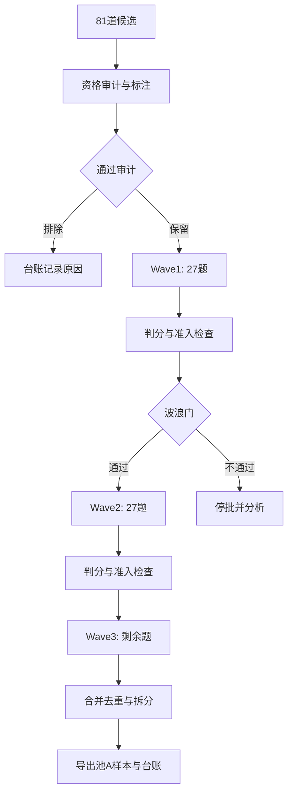

# 原契约 SWE SFT 正式生成方案

日期：2026-10-21。状态：**方案待确认，未开始生成**。本方案采用**原契约**（`contract_review=False` 的默认提示 + 数据契约），不启用经消融验证无收益的 `public-contract-v1`。

## 0. 结论摘要

| 项 | 计划值 | 依据 |
|---|---|---|
| 教师 | `deepseek-flash`，`reasoning_effort=low`，保留历史思考 | 现有 `configs/llm/local_deepthink.yaml` |
| 工具面 | DSH 三工具 `bash/read/edit`，原生 tool calls，自然停止 | `dsh_compat` 已对齐并验证 |
| 步数 / 并发 | 60 步 / 6 并发 / 实例异常重试上限 3 | 与 50 题批一致 |
| 导出长度门 | 81,920 | 50 题批实测 0 条超窗丢弃 |
| 可用题量 | **81 道**（本样本剩余未跑） | 158 条头部样本中已用 77 条 |
| 预期通过 | 约 40 道（50% 通过率） | 50 题批实测 25/50 |
| 预期可用样本 | 约 30–35 条 | 需再过内容/回归/去重/资格四道门 |
| 预计 token | 约 6,000 万 prompt + 126 万 completion | 每条通过 ≈1.49M + 31k |

**关键约束：不做全库 2 万题的"大规模"，因为本地只有 158 条头部样本，剩余 81 道是硬上限。**要突破必须另行获取完整数据集（下载、镜像拉取、磁盘与时间成本需单独确认）。

## 1. 生成前必须先做的三件事

### 1.1 修复 file 工具工作目录绑定（建议先做）

现状：`DSHCompatAgent.from_config` 用全局 `config.runtime.workdir` 初始化 file 工具，若与实例 workdir 不一致，`_confine` 会拒绝合法路径。上一轮对照已出现 **4 次 workspace 拒绝 + 1 次错路径找不到文件**。

- 影响：会凭空制造"读不到/改不了"的失败，污染通过率与轨迹。
- 做法：把 workdir 改为按实例解析（`task.get_instances` 后由 runner 传入），不改工具 schema 与提示。
- 验证：10 题小样本，断言 0 次 workspace 拒绝，且对比同 10 题历史结果的差距仅来自该缺陷。
- 代价：约 10 题 ≈ 30 万 prompt token。

若不修，则必须在准入台账里把"因路径拒绝失败"单独标记并剔除，且接受约 8%–15% 的噪声。

### 1.2 任务资格审计（零教师成本）

对 81 道候选做静态标注，不调用模型：

| 标注 | 判据 | 处置 |
|---|---|---|
| `contract_ambiguous` | 公开 issue 未给出、但测试依赖内部 helper 名 | 单独成表，不进池 A |
| `known_unsolvable` | 需改测试/快照才能过 | 直接排除 |
| `infra_risk` | 镜像缺失、依赖不可离线装 | 排除并记录 |
| `leak_risk` | 容器构建元数据含未来版本文件名/文案 | 记录，命中即排除 |

同时确认 `FAIL_TO_PASS` 与 `PASS_TO_PASS` 非空且可解析。

### 1.3 冻结基线

写入 `manifest`：数据文件 sha256、提示 sha256、工具 schema sha256、模型与预算、长度门、并发与重试。任一变化必须开新 run 目录，禁止覆盖。

## 2. 分批计划

| 波浪 | 题量 | 目的 | 通过条件才继续 |
|---|---:|---|---|
| Wave 1 | 约 27 | 验证工具修复、成本与通过率是否稳定 | 通过率 ≥40%、0 infra 错误、无路径拒绝 |
| Wave 2 | 约 27 | 规模验证与家族分布检查 | 同上，且新增样本去重后 ≥90% 保留 |
| Wave 3 | 剩余 | 收尾 | 不限 |

每波独立 run 目录，互不覆盖；波浪之间不重新采样已通过题。

## 3. 准入检查（逐条硬门）

1. **真实判分收据**：`eval_result` 无 error，F2P 全过、P2P 全过。
2. **不碰测试**：补丁与轨迹都不得写入 tests/、fixtures、snapshot；发现即弃。
3. **编辑后验证**：最后一次改文件之后必须存在测试执行。
4. **长度**：Qwen 模板渲染后 ≤81,920 token，且 mask 与 ids 等长。
5. **思考覆盖**：至少一个非空 `<think>` 且在 mask=1 内。
6. **去重**：同 issue 家族、补丁近重复、命令重复率超阈值的剔除。
7. **隔离**：不含 SWE-bench Verified / LCB 的 ID 与近重复。
8. **资格**：未命中 `contract_ambiguous` / `leak_risk` 标注。

每条样本在台账里保留：instance_id、判分收据、F2P/P2P、序列长度、监督 token、工具分布、准入结论与理由。

## 4. 成本与时间

| 项 | 单值 | 81 题合计 |
|---|---:|---:|
| LLM 调用 | 27.4 次/题 | 约 2,220 次 |
| prompt token | 743k/题 | 约 6,020 万 |
| completion token | 15.5k/题 | 约 126 万 |
| 单题 agent 时长 | 232 s | 并发 6 下约 52 分钟串行折算 |
| 判分容器 | 每题一次独立容器 | 与 agent 时长同量级 |

token 与时长来自 50 题批实测；**未包含货币费用**（无计费收据），也未包含镜像拉取时间。

## 5. 预期产出与不确定性

- 通过 40 道左右 → 过准入门后约 **30–35 条**池 A 样本；
- 每样本均值 26.9k token、监督约 10.3k（50 题批实测）；
- 不确定性：题目分布偏 qontract（26/50）与 beets（10/50），跨库泛化未知；低思考教师在这批困难题上通过率约 50%，换题集可能显著波动。

## 6. 本方案明确不做的事

- 不启用 `public-contract-v1`（消融无收益）；
- 不把独立重试的失败/成功拼成池 B 纠错样本；
- 不因"差一两个断言"放宽全门；
- 不把 `contract_ambiguous` 题混入池 A 充数；
- 不在同一批里更换教师或思考档（要换就开独立对照）。

## 7. 需要确认的决策

1. 是否先修 file 工具工作目录绑定（推荐：修，约 10 题成本）。
2. 规模是否就按 81 题封顶；若要更大，需要另行获取完整数据集。
3. 是否接受 50% 左右通过率下的 30–35 条产出，或先做一档更高思考强度对照再定教师。

## 8. 交付物

- 每波 run 目录：`results/pool_a_formal/wave{N}/<model>_<ts>/`（`results.jsonl`、`trajectories.jsonl`、`sft_qwen.jsonl`）
- 准入台账：`results/pool_a_formal/admission_ledger.jsonl`
- 资格审计表：`results/pool_a_formal/qualification.json`
- 汇总报告：`docs/工程问题/2026-10-21-池A正式生成报告.md`
- 冻结清单：`results/pool_a_formal/manifest.json`
