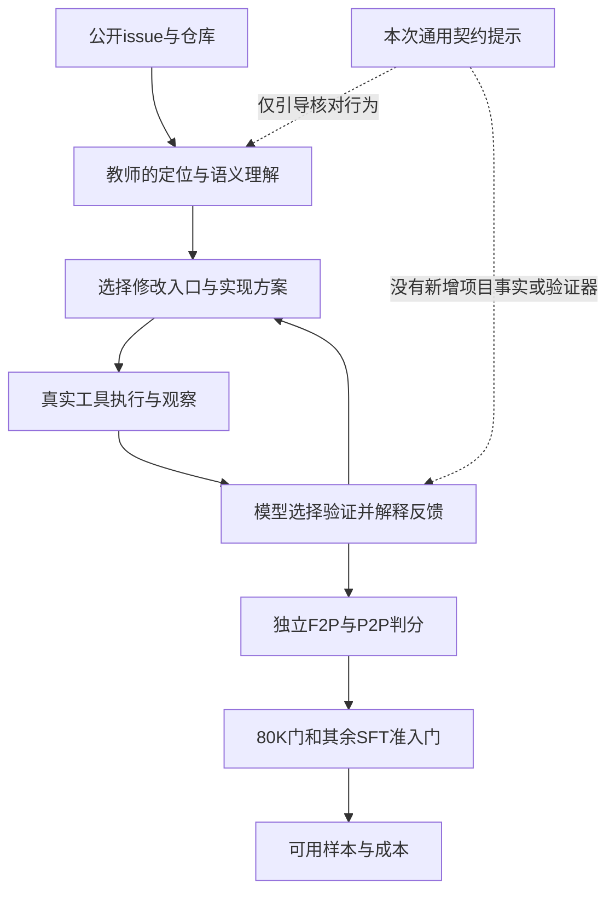

# 教师能力与数据制造效率瓶颈分析

日期：2026-10-21。范围：只复核现有消融收据与实现，不调用新教师、不改提示默认值或训练配置。本轮没有新增模型对照，因此不能宣称识别出了教师能力的固有上限。

## 判断

证据支持“当前教师＋low思考＋现有脚手架，在这个失败子集上存在稳定困难”，但没有把教师模型、推理强度、工具反馈和测试契约的影响分离。通用契约提示没有观察到收益，不等于所有契约改进无用，也不等于换教师一定有效。

本次干预是增加核对流程文字，并没有增加可靠的项目事实、工具反馈、需求检查器或新的推理能力。它要求模型更仔细，但执行核对和判断核对是否正确，仍依赖同一个模型。

## 已证实事实

来源：[统计收据](<E:/Deeplearning/local_train/swefactory_self/results/contract_retry_v1/analysis_summary.json>)、[逐题配对表](<E:/Deeplearning/local_train/swefactory_self/results/contract_retry_v1/paired_table.md>)、[实验清单](<E:/Deeplearning/local_train/swefactory_self/results/contract_retry_v1/manifest.json>)。

| 指标 | 原提示重新采样 | 通用契约增强 |
|---|---:|---:|
| 原失败子集题目通过 | 2/25 | 1/25 |
| F2P目标测试通过 | 35/80 | 33/80 |
| P2P通过 | 3278/3282 | 3278/3282 |
| 累计API输出token | 484649 | 462585 |
| 每条通过的输出成本，包含失败尝试 | 242324.5 | 462585 |
| 80K门后保留候选 | 2 | 1 |

- 25题是原50题的失败子集，不能把8%或4%解读成教师在全库的通过率。
- 22题在原运行及两次复测中均失败，说明这批困难不能靠本次提示或一次重采样轻易消除；不证明任务不可解。
- 契约组单次尝试平均输出成本少4.55%，但题目通过数减半，导致每条通过输出成本增加90.90%。输入token总量也下降，但没有实际计费与缓存收据，不能推导货币费用。
- 两臂通过样本均没有被80K门丢弃。当前通过率瓶颈不在导出长度门；80K训练可行性仍是另一个问题。
- 单次每题每臂、顺序运行、没有固定seed；新增成功1、退化2的差异不足以证明普遍优劣。

## 原因分层

### 1. 教师的有效修复能力是重要嫌疑，但尚未隔离

pr1125契约组直接遍历manifest.data，漏了带items的字典结构；pr931契约组改权限检查入口，没覆盖实际仓库注册验证；cookiecutter两臂都保留4个原有回归。这些不是“没生成补丁”，而是数据结构、调用链、兼容语义和验证覆盖上的错误。

这些案例支持模型在当前推理与工具条件下未能稳定完成理解、定位和验证。它们不能量化其中多少由模型容量、low思考预算、检索不足或反馈质量造成。原提示有时能解同一道题，也说明不宜直接称为固有能力上限。

### 2. 行为提醒没有形成独立的纠错反馈

[新增提示](<E:/Deeplearning/local_train/swefactory_self/aweagent/scaffold/dsh_compat/contract_review.py>)让教师识别要求、读调用点、核对接口、做直接检查。但如果教师本来就误解输入或入口，仍可能写一个符合自身假设的自测，再错误认为修复完成。当前结果与这个机制相容，不过尚未逐步测量它的发生频率。

要提高成功概率，需要核准真实输入和执行入口的证据，或能暴露原假设错误的独立验证；单纯增加“认真核对”的指令不保证提供这些信息。

### 3. 现有脚手架有干扰项

[agent配置绑定](<E:/Deeplearning/local_train/swefactory_self/aweagent/scaffold/dsh_compat/agent.py#L59>)用全局runtime.workdir初始化file工具，[路径检查](<E:/Deeplearning/local_train/swefactory_self/aweagent/scaffold/dsh_compat/tools.py#L24>)据此拒绝不匹配路径。现有报告记录对照组4次workspace拒绝与1次错路径找不到文件。

同一缺陷保留在两臂中，能控制实验版本差异，但不代表没有影响；不同提示可能走不同工具路径。不能把所有损失归给教师。先修复明确工具缺陷，比在有已知干扰的条件下扩大教师对照更容易解释。

### 4. 部分判分失败混入内部实现约定

如unique_list、_check_rsync_binary等helper名字并非全部由公开issue明确指定。缺这个名字可能意味着修复不完整，也可能意味着测试依赖特定实现。需要资格审计，不能统一解释为“能力差”或“任务不公平”。公开要求明确的输入解包、异常语义、调用入口问题则不能推给隐藏测试。

### 5. 低思考适合学生，不等于低思考教师最省成本

当前[教师配置](<E:/Deeplearning/local_train/swefactory_self/configs/llm/local_deepthink.yaml>)始终为deepseek-flash、low effort。本次不是low与更高思考强度的对照；早期非思考与低思考试跑还同时更换了model，不能用它证明low最优。

学生是thinking模型，意味着数据需有正确保留并监督的思考与动作；并不逻辑上要求教师也只能用low。更强教师或更高思考若显著提高通过率，即使每次较贵，也可能降低每条通过成本。相反，若只是多生成推理而成功率不变，就不划算。改变教师策略后还需检查轨迹长度、可模仿性和训练效果。

## 最小鉴别实验建议（尚未执行）

1. 先单独修复并验证文件工具工作目录绑定，冻结修复后的工具面，不同时更改停止策略和判分规则。
2. 按失败现象分层选固定小题集，包含公开行为明确、跨模块定位、兼容性回归，以及少量原成功题；先剔清无法公平判定的资格问题。
3. 比较三组：当前教师low；同教师API确实支持的更高思考档；更强教师。保持原提示、任务信息、工具环境和共同预算口径，记录实际成本，不向任何组提供隐藏判分线索。
4. 每题每组至少多于一次采样以区分随机性；比较题目通过、F2P/P2P、80K内候选数，以及每条通过的输入/输出和实际费用。不能只比较输出短不短。

如果同教师更高思考改善，优先判断为推理预算/策略限制；如果更强教师改善而同教师加思考不改善，才更支持模型能力差距；如果各组反复撞相同内部符号约定，优先审计测试资格；如果修工具已改善，则原结果含脚手架因素。这些是可区分假设的方向，不是当前已得结论。

## 工程与验证状态

本轮新增本分析文档，未修改任何运行代码、默认提示或模型配置。复读原始汇总、25行配对表、实际提示和工作目录绑定代码；没有启动新采集、训练或付费实验。原消融实现的六项回归检查及收据一致性检查已在前轮通过，不将其写成本轮新测结果。

目前建议继续保持通用契约增强默认关闭，先消除明确的工具问题，再做小规模教师/思考档对照，而不是继续叠加提示或对顽固失败题大批同条件重试。
