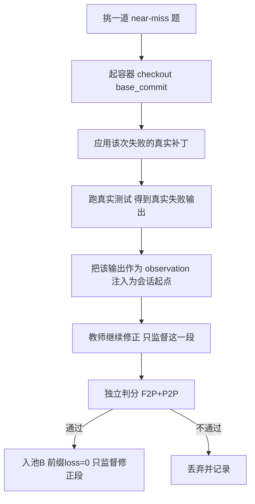

# 池 B / 池 C 构造方案（基于已完成批次）

日期：2026-10-21。输入：`results/pool_a_formal/`（878 题尝试，449 条池 A 准入）。种子清单见 `results/pool_a_formal/pool_seeds.json`。

## 0. 结论

| 池 | 可用种子 | 是否需要新采集 | 建议优先级 |
|---|---:|---|---|
| **C2 及时停** | **196**（已验证后停止） | 否（从现有轨迹筛） | 最高，零成本 |
| **C1 早落地** | **211**（首个修改 ≤6 步）/ 292（≤8 步） | 否 | 高 |
| **C3 诚实失败** | **2**（空补丁失败） | 少（需专门采） | 中 |
| **B 近失纠错** | **189**（F2P 部分通过后失败） | **是**（需新增"失败状态续写"模式） | 高，但工程量最大 |
| B 回归修复 | 21（P2P 被打红） | 是 | 中 |
| B 方向错误 | 43（改过测试文件而失败） | 是 | 低（负例价值大于正例） |

## 1. 池 C：从现有轨迹直接筛（零教师成本）

判据都可在轨迹上机器判定，不需要重新跑题。

### C1 早落地（反独白）

首批修改发生在第 k 步，k 越小越像"先动手"。实测分布（449 条准入样本，首修改步数）：

| 分位 | p10 | p25 | p50 | p75 | p90 |
|---|---:|---:|---:|---:|---:|
| 步数 | 4 | 5 | 7 | 10 | 14 |

| 阈值 | 样本数（占比） |
|---|---:|
| ≤4 步 | 72（16%） |
| **≤6 步** | **211（47%）** |
| ≤8 步 | 292（65%） |
| ≤10 步 | 358（80%） |

建议取 **≤6 步**入 C1（211 条），保留 ≤4 的 72 条作"强落地"子集。

### C2 及时停（反循环）

已在 449 条中筛出 **196 条**满足：最后一次修改之后有测试执行，且之后没有新的修改就结束。这是"跑通就停"的正样本。

### C3 诚实失败

现有数据里**只有 2 条**空补丁失败——说明当前教师极少"诚实放弃"，这一池**不能靠筛**，需要刻意采。采集方法：挑已知不可解/超预算题，在提示里明确"无法完成时说明原因并停止"，把 `finish` 前后的完整轨迹留作样本；**与已验证成功分开计数**，不得混入 A 的比率。

### 去重与规模

C1 与 C2 会重叠（既早动手又验证后停）。必须按 instance 去重后再算池大小；重叠规模我尚未统计。按 449 条 A 的配比（A 55% / C 17%）估算，C 池需要约 140 条，现有 C1+C2 去重后大概率够用，C3 需另采 20–40 条。

## 2. 池 B：真实失败 → 修正（需要新模式）

**关键约束（已验证）**：两次独立重试不能拼成纠错样本——第一次失败与第二次成功之间没有因果链，模型没看见失败观察。B 必须要求"同一次会话里，真实工具反馈暴露错误，随后教师修正"。

### 现成种子

| 类型 | 数量 | 为什么适合做 B |
|---|---:|---|
| F2P 部分通过后失败 | **189** | 已经修对一部分，失败点是真实反馈暴露的边界/契约问题 |
| P2P 被打红 | 21 | 典型"修 A 破 B"，纠错信号最干净 |
| 改过测试文件而失败 | 43 | 方向错误的负例（但正例必须只改源码） |
| 空补丁失败 | 2 | 更适合 C3 |

### 构造流程（需实现，不改判分规则）

需要的三项能力：

1. **工作区快照**：失败后保留 `git diff`（已有 patch）即可重建起点，用 `pre_commands` 在容器里 `git apply`；
2. **观察注入**：把真实 pytest 输出作为首条 user 消息附在 issue 之后——这是模型自己也能跑出来的东西，不算泄露隐藏测试；
3. **监督切分**：任务提示与注入的失败观察 `loss=0`，只监督教师的修正动作与其后的验证。

风险与红线：

- 注入的必须是**真实**失败输出，不能由 LLM 编造；
- 失败补丁来自教师自己，不是 gold patch；
- 修正段必须**重新跑测试并全绿**才准入；
- 不得把"改测试让它过"当作修正。

### 工作量估计

约 1 个新模式（`correction` 模式）+ 1 个导出器：容器起停、patch 应用、观察注入、段级 mask 切分、判分复用。参考现有 `dsh_compat` 与 `formal_export` 的结构，估 300–500 行，**不需要改判分**。

## 3. 建议顺序

1. **先做 C（零成本）**：跑一个筛选脚本产出 `pool_c.jsonl`（含 C1/C2 去重、C3 单列），今天就能有 150± 条行为样本；
2. **再做 B 的 P2P 回归子集（21 条）试点**：样本最小、信号最干净，用来验证"失败状态续写"链路；
3. 链路验证通过后再扩到 189 条 near-miss；
4. C3 单独采一批，绝不与 A 混算。

## 4. 尚未验证的部分

- C1/C2 重叠规模未统计；
- B 的"注入观察"是否会被判分脚本视为污染（需要看 evaluator 是否重置工作区）；
- B 修正段的长度分布未知，可能显著长于 A（前缀 + 修正），需要重新算 64K 门。
