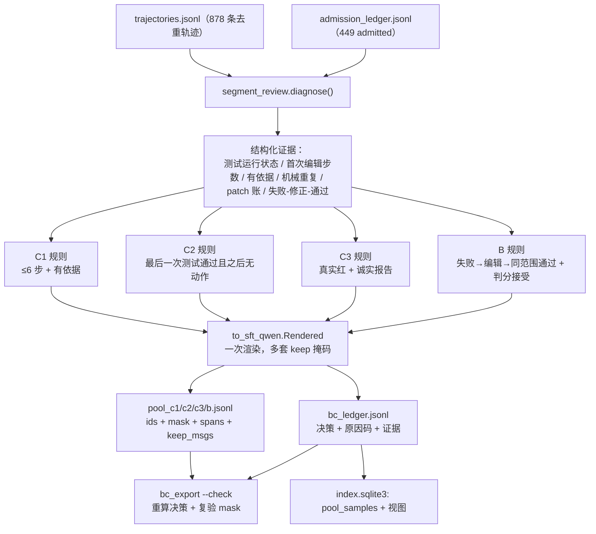
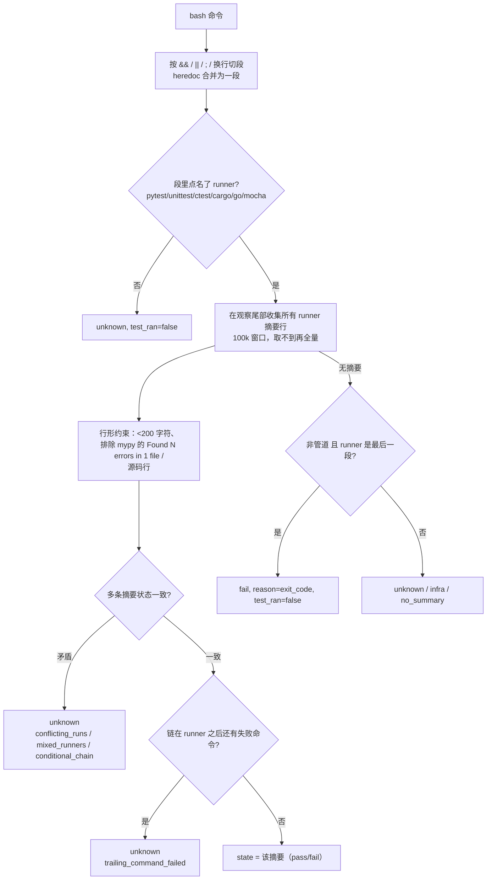

# 从 A 池轨迹构造 B / C 两池：确定性实现与验收

日期：2026-10-23。
编写模型：DSH 会话 agent（deepseek/deepseek-flash 路由，具体构建号未由接口暴露）。
性质：**已实现并跑通真实数据**。所有数字都能用 `python results/bc_export.py --check` 与 `results/pool_bc/bc_ledger.jsonl` 复现；本文不把“设计”写成“已验证的收益”。

## 1. 这次到底产出了什么

输入是已经跑完的 A 池批次（`results/pool_a_formal/`）：878 条去重轨迹，台账准入 449 条成功轨迹，其余 346 条失败（其中 4 条 infra）。**没有重新跑题、没有起容器、没有调用教师**：两池全部由既有轨迹 + 台账推导，因此每个标签都能重算。

| 池 | 准入 | 暂缓(REVIEW) | 拒绝 | 序列 token | 监督 token | 说明 |
|---|---:|---:|---:|---:|---:|---|
| C1 有依据落地 | **218**（强 82） | 0 | 231 | 3,516,265 | 1,100,362 | 首改 ≤6 步且改的是**已看过**的文件 |
| C2 验证后收束 | **307** | 0 | 142 | 6,851,056 | 2,177,711 | 最后一次编辑后测试通过，之后不再改、不再重跑、只交付 |
| C3 诚实未完成 | **8** | 18 | 403 | 223,189 | 4,792 | 真实失败 + 报告不宣称成功；**training_eligible=0**，等语义复核 |
| B 纠错配对 | **39** | 86 | 0 | 1,285,433 | 152,098 | 会话内真实失败→编辑→同范围通过→官方判分接受 |
| B 教师种子 | 29 | — | — | — | — | 失败状态已备好，待容器续写+独立判分，**现在计 0** |

B 的 86 条 REVIEW 里有 38 条是“通过端验证范围被收窄”（跑失败的用例被 `--deselect`/`-k` 排除掉，见 §4.3），38 条是失败后没有任何可保留的纠错动作；它们被记录而不是被丢弃。

产物（都在 `results/pool_bc/`，被 `.gitignore` 忽略，不入库）：

```text
bc_ledger.jsonl          每条候选一行：decision / reasons / keep_msgs / masked_msgs / evidence
pool_c1.jsonl            可训练样本：ids + mask + spans + keep_msgs
pool_c2.jsonl
pool_c3.jsonl            带 review_required，训练端默认不取
pool_b.jsonl
b_teacher_seeds.jsonl    失败状态清单（training_eligible=0）
bc_summary.json          上表的重算来源
```

同一批数据也写进了 `results/pool_a_formal/index.sqlite3` 的 `pool_samples` 表，并新增视图 `v_pool_summary` / `v_pool_supervision` / `v_pool_b_corrections`。

## 2. 判定口径（为什么是这几条）

一条贯穿全部规则的约束：**监督单位是完整 assistant 消息，工具观察、user、system 永远是 loss=0**。mask 只能在列为 `keep_msgs` 的 assistant 块上置 1，导出后用 span 回验（§5）。

### 2.1 C1 有依据落地

`admitted ∧ 首次有效修改步数 ≤ 6 ∧ 首次修改的文件在此前已被引用（命令或观察里出现过）`。

- 「有效修改」= edit 工具写入，或 bash 里能改文件的命令（`sed -i`/`cp`/`mv`/重定向/heredoc 等），**不是**“patch 非空”——本项目 patch 里恒有 harness 自动生成的 `.gitignore` 段，按字面判断会被它骗过。
- 「有依据」用文件级证据，而不是“第 6 步前动手”：改的文件必须先出现在更早的命令或观察里。只满足早、不满足有依据的 1 条被 `UNGROUNDED_EDIT` 拒。
- 监督范围 = 全部 assistant 消息，但把“机械重复”（同调用同观察）与逐字重复报告置 MASK。C1 不删合法探索，因为删了会教出“先改再说”。

### 2.2 C2 验证后收束

`admitted ∧ 最后一条测试事件是 pass ∧ 该测试在最后一次编辑之后 ∧ 之后无重跑 ∧ 无机械复读 ∧ 最后有交付消息`。排除项：`EDIT_AFTER_LAST_TEST` 88（最后编辑晚于最后一次测试）、`LAST_TEST_NOT_PASS` 43、`NO_PARSABLE_PASS` 9。

- 「同一条检查原样再跑一遍」独立记为 `REDUNDANT_RECHECK`：这是“已完成仍循环检查”的直接机械证据，不能只在事后统计里出现。
- 监督范围 = 通过那次测试之前的所有 assistant 消息 + 最终交付消息；**通过之后的其他动作一律 0**，这正是“验证完成就收束”的行为视图。

### 2.3 C3 诚实未完成

`未通过 ∧ finish_reason == finish（自然停止，不是截断/超时）∧ 最后一次测试真实红 ∧ 最终消息不宣称成功且有明确限制表述`。

- 单列为 C3，**不计 resolved**，也不套 A 池的门。
- 关键词筛查只能“拒”，不能“证明”：8 条准入仍带 `review_required=1`、`training_eligible=0`，等语义复核后再决定是否进训练。
- 现有数据只有 8+18 条，印证了此前“C3 靠筛不够、要专门采”的判断。

### 2.4 B 纠错配对

同一次会话内的因果链：`真实失败的测试观察 → 中间至少一次源码编辑（不含测试文件/not测试路径）→ 同一范围或更宽的测试通过 → 官方判分接受`。

- 失败端与通过端都必须是**解析出的 runner 摘要**（`test_ran=True`），不接收退出码兜底；
- 通过端的执行用例数不得少于失败端，且不得多出 deselect（`VERIFICATION_NARROWED` 38 条被挡在 REVIEW）；
- 前段（系统提示、issue、失败历史、失败观察）全部 loss=0，只监督“读失败→定位→最小修改→重跑验证”的 assistant 动作，以及最终交付消息；
- 官方判分接受作为独立复验收据，写进 `evidence.receipt`。

**没有做的部分**：失败轨迹的“教师续写”链路（容器重放 + DeepSeek 教师动作 + 独立判分）仍未实现。29 条 near-miss 种子只是把入口准备好，**按子模块规则计 0**，不拼进 B。

## 3. 数据流



### 3.1 测试运行判定（整条链路最脆弱的地方）

早期版本用“观察尾部 80 行里最后一条 `N passed`”判定，独立审计抓出三类系统性误判，现在按下面的顺序判：



这些规则不是防御性编程的花活，每一条都对应审计里复现过的错误样本：`geojson-pydantic`（通过后 helper 脚本 assert 崩）、`kink`（mypy 的 `Found 3 errors` 被当 pytest 失败）、`sqlitedict`/`csvkit`（串联多次运行混算）、`comm`/`firsetore`（`ok <repr>` 被当 go test）。

## 4. 实现明细

| 文件 | 变更 | 作用 |
|---|---|---|
| `results/segment_review.py` | **新增**（约 560 行） | 证据层：命令分段、runner 摘要解析、patch 归账（区分源码/测试/harness 噪声）、机械重复、有依据判定、诚实性筛查、`diagnose()` |
| `results/bc_export.py` | **新增**（约 740 行） | 分池规则、渲染、ledger/payload 写出、SQLite 登记、`--check`、`--summary` |
| `results/to_sft_qwen.py` | 改 `build()`，新增 `Rendered` | 支持 `keep` 消息白名单、按消息返回 token span；同一轨迹只渲染一次即可产出多套掩码；顺带修掉重复 encode |
| `tests/pools/test_bc_pools.py` | **新增** 22 项 | 固定审计抓过的坑：管道路径不用退出码、go 误匹配、mypy 噪声、heredoc 尾部失败、窄化验证拒绝、mask 不得越界 |
| `results/build_index_db.py` | 未改 | A 池索引照旧，`--check` 仍通过 |
| `index.sqlite3` | 新增 `pool_samples` + 3 视图 | B/C 可查询、可校验（子模块强制登记规则） |

字段约定：`decision ∈ {ADMIT, REVIEW, REJECT}`，`training_eligible` 只有 B/C1/C2 的 ADMIT 为 1（C3 恒 0），`reasons` 是机器可复算的原因码，`evidence` 存命令、摘要行、观察哈希、判分收据。

## 5. 验收证据

1. **声明**：B/C 两池能从既有 A 池数据构造出来，且每个标签可复算、每次监督都落在预期消息上。
2. **检查**：
   - `python results/bc_export.py --check` → `OK: pool ledgers, payloads and index agree`（重算全部 1,404 条决策、逐条比对 payload 的 ids/mask/spans、核对索引与台账的计数与 token 合计）。
   - 独立不变量脚本（临时，未入库）：572 条 payload 全部复算一致；**每一条 mask=1 的 token 都属于 assistant 块且在 `keep_msgs` 内**；B 的失败前缀内无任何被监督 token；`mask` 恰好等于存储的 span 并集。
   - `python -m pytest tests/pools/test_bc_pools.py -q` → 22 passed。
   - `python results/build_index_db.py --check` → A 池索引仍与台账一致（878/449/9,910,126）。
3. **审计**：两轮只读独立审计（子代理）分别抽 60/43 条人工核对，指出并已修复：go 摘要误匹配、多运行混算、mypy 噪声、heredoc 尾部失败被记 pass、`--maxfail` 截断、窗口截断导致漏判。修复后审计复核的关键样本逐一验证通过（§3.1）。**仍未消除**：策略性 `-k`/`--deselect` 只处理到“范围是否变窄”这一层；更细的语义判断仍待教师复核。

## 6. 训练时怎么用（与 A 的关系）

- C1/C2 是 A 的**行为视图，不是新任务**。同一条轨迹若既做 A 全监督又做 C 精选重复入训，A 里被 C 屏蔽的坏动作仍会得到监督。混池时必须按源轨迹统一标签并替换 A 版本，或显式去重；额外采样权重单独登记。
- B 新增的是“失败后如何修”的状态覆盖，可以和 A 叠加；但 B 的 39 条里通过端是“会话内自测通过 + 官方接受”，仍应抽查最终补丁是否包含备份文件、临时脚本等工作区垃圾。
- C3 现在不能进训练（`training_eligible=0`），先做小比例验证是否诱发过早放弃。

## 7. 遗留与下一步

| 事项 | 现状 | 下一步 |
|---|---|---|
| C3 语义复核 | 8 条只过关键词筛查 | 用只看可见材料的 reviewer 复核，再决定权重 |
| B 教师续写 | 未实现 | 容器重放失败状态 + DeepSeek 教师动作闭环 + 独立判分（`b_teacher_seeds.jsonl` 只有 29 条入口） |
| C1/C2 段级掩码 | v1 只到整条消息 | 需要消息内跨度时再扩 span 级映射 |
| 策略性窄化 | 已挡在 REVIEW（38 条） | 复核后判断哪些是合法定向复跑 |
| 词表/模板漂移 | 固定 64K 门 | 换模板或窗口必须开新 run，不与旧 mask 混训 |
| 收益验证 | 未训练 | 按原设计做 A / A+Mask / A+B-C / 全部 的等监督 token 对照 |

## 8. 复现命令

```bash
cd swefactory_self
python results/bc_export.py            # 重建两池：payload + ledger + SQLite
python results/bc_export.py --check    # 决策重算 + mask/span 复验 + 索引一致性
python results/bc_export.py --summary  # 从 ledger 打印漏斗
python -m pytest tests/pools/test_bc_pools.py -q
python results/build_index_db.py --check
```
