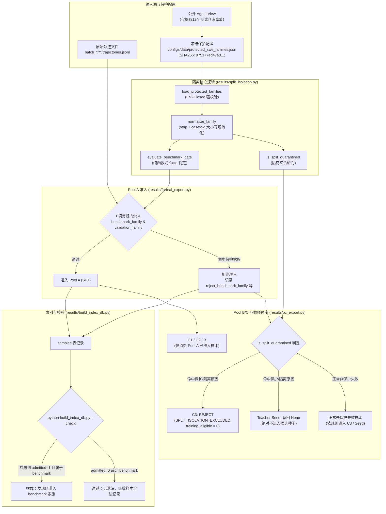

# SWE 任务家族划分与测试集隔离防护工程记录

**归档时间**：2026-10-23
**执行角色**：SWE 数据工厂工程师（模型：antigravity/gemini-3.8-flash，推理强度：medium）

---

## 1. 背景与根因分析

### 1.1 背景
现场 lead 在核对本地公开 `eval/data/swe-verified/agent_view.jsonl`（500 行，SHA256: `7fc3c8e1d9ae2e701e16b4d9439dbcbb0a541c2cdfc1ef2d5cb9a2f1a4e712fe`）的仓库家族时，发现 SQLite 池 A 中历史准入了 `pallets_flask_pr3574`（`family=pallets/flask`）。该家族属于 SWE-bench Verified 正式评测集仓库家族。

依据仓库协作规范（`AGENTS.md`）：
- **训练与评测严格隔离**：SWE-bench Verified 正式集及其同家族任务不得回流进入训练池（Pool A、Pool B、Pool C）或教师续写种子（Teacher Continuation Seeds）；
- 任务家族必须统一进行 split 划分，禁止混淆 train / test。

### 1.2 根因分析
1. **历史准入判定缺失 benchmark family gate**：此前 `results/formal_export.py` 仅对 `validation_families` 进行硬过滤，未加载并阻断已公开的 12 个 SWE-bench Verified 家族（如 `pallets/flask`、`django/django`、`sympy/sympy` 等）。
2. **家族名称大小写敏感风险**：历史代码直接使用原始字符串 `family in validation_families`，若出现首尾空白或大小写变体（例如 `Pallets/Flask`），可能绕过集合过滤。
3. **衍生池（Pool C3 / Teacher Seeds）隔离缺口**：Pool A、B、C1、C2 均依赖 `admission.get("admitted") == True`，当 Pool A 排除后会自动排除；但 Pool C3（诚实未完成）与 B 失败教师续写种子（Teacher Seeds）从非准入（未通过）记录中筛选。此前未过滤 `benchmark_family`、`validation_family` 或 `unknown_task` 等隔离拒绝原因，导致保护家族的失败轨迹仍可能进入 C3 或教师续写种子。
4. **数据库索引校验缺乏受保护家族防御**：`results/build_index_db.py --check` 此前未对已准入样本的家族做 benchmark 判定，无法及时在校验阶段发现泄漏。

---

## 2. 架构与流程逻辑（Mermaid 图）



---

## 3. 工程修改内容说明

本次修改严格限制在指定范围内，未改动任何生产运行脚本（如 `run_formal_batches.py`）、教师配置、模型审核文件，未动用网络 API 或 Docker，未改写正在生成的正式台账与数据库：

| 文件 | 变更性质 | 修改要点 |
| :--- | :--- | :--- |
| `configs/data/protected_swe_families.json` | **新增文件** | 冻结包含 12 个 SWE-bench Verified 家族（`astropy/astropy`, `django/django`, `matplotlib/matplotlib`, `mwaskom/seaborn`, `pallets/flask`, `psf/requests`, `pydata/xarray`, `pylint-dev/pylint`, `pytest-dev/pytest`, `scikit-learn/scikit-learn`, `sphinx-doc/sphinx`, `sympy/sympy`）的元数据；记录 `dataset`、`split=test`、`source_count=500`、`source_agent_view_sha256`（`7fc3c8e1d9ae2e701e16b4d9439dbcbb0a541c2cdfc1ef2d5cb9a2f1a4e712fe`）；绝不包含 gold patch、测试用例或问题描述。 |
| `results/split_isolation.py` | **新增文件** | 1. `load_protected_families`: 严格校验配置完整性，文件缺失或格式无效时 **Fail-Closed**（抛出 `SplitIsolationConfigError`）；<br/>2. `normalize_family`: 使用 `.strip().casefold()` 实现统一的大小写无关对比；<br/>3. `evaluate_benchmark_gate`: 提炼纯 Gate 函数供导出与测试调用，返回 `(passed, reason)`；<br/>4. `is_split_quarantined`: 综合检查 `validation_family`、`benchmark_family`、`unknown_task` 拒绝列表或受保护家族归属。 |
| `results/formal_export.py` | **修改文件** | 1. 准入增加 `benchmark_family` 门禁；<br/>2. `validation_families` 与 `family_duplicate` 统一采用规范化比较；<br/>3. `summary` 记录保护配置 SHA256（`protected_families_sha256`）与新的准入协议标识 `"formal-v3-benchmark-isolated-cap-one"`；保持单家族一题规则与 first iid winner。 |
| `results/build_index_db.py` | **修改文件** | 1. `GATE_NAMES` 列表加入 `"benchmark_family"`；<br/>2. `check()` 函数增加校验逻辑：检索 `samples` 表中已准入样本（`admitted=1`），若发现命中 `benchmark_family`，立即记录 problem 并不允许通过校验；同时不误伤 `admitted=0` 的合法 failure。 |
| `results/bc_export.py` | **修改文件** | 1. `evaluate_c3`: 检查 `is_split_quarantined`，若包含隔离拒绝原因（`validation_family`, `benchmark_family`, `unknown_task`）或属于保护家族，返回 `base_row("C3", ..., "REJECT", ["SPLIT_ISOLATION_EXCLUDED"])`，确保 `training_eligible=False`，绝不进入训练候选；<br/>2. `evaluate_b_seeds`: 检查 `is_split_quarantined`，命中则直接返回 `None`，不生成教师续写种子；<br/>3. 保持 export 与 check 派生重算完全一致。 |
| `tests/pools/test_split_isolation.py` | **新增文件** | 完整覆盖 6 大核心验证点（Case-insensitive、Flask 不得 A 准入、C3/Seed 排除、非保护失败不误伤、缺配置 Fail-Closed、索引数据库校验）。 |

---

## 4. 验证测试执行及结果

### 4.1 自动化测试执行
在 `tests/pools` 目录下执行全量回归与新增专项测试：
```bash
pytest tests/pools
```
**执行结果**：
```text
tests\pools\test_bc_pools.py .........................                   [ 32%]
tests\pools\test_model_review_bulk.py ..................                 [ 55%]
tests\pools\test_production_resume.py ...........                        [ 69%]
tests\pools\test_review_release.py ...........                           [ 83%]
tests\pools\test_semantic_provenance.py ...                              [ 87%]
tests\pools\test_split_isolation.py ..........                           [100%]

======================== 79 passed, 1 warning in 1.53s ========================
```
- 新增隔离测试通过。主导者随后补强：保护配置必须是500条Verified test且SHA格式有效；空或格式无效家族不能进入C3/教师种子；索引check直接验证真实函数，并按归一化家族检查重复。最终 `python -m pytest tests/pools -q`：**79 passed, 1 warning**。

### 4.2 专项测试证据清单
1. **大小写折叠隔离**：`pallets/flask`、`Pallets/Flask`、`PALLETS/FLASK`、`  pallets/flask  ` 均准确命中；
2. **纯 Gate 与 Formal 准入**：`evaluate_benchmark_gate` 对 `pallets/flask` 返回 `(False, 'benchmark_family')`，仿真 formal pipeline 准确拒绝；
3. **C3 与教师种子隔离**：受保护家族的失败样本在 `evaluate_c3` 中输出 `decision="REJECT", training_eligible=False`，在 `evaluate_b_seeds` 中返回 `None`；
4. **非保护合法 failure 防误伤**：非保护库的失败轨迹正常评估，未受 `SPLIT_ISOLATION` 误伤；
5. **Fail-Closed 校验**：配置文件丢失或缺少必需字段时立即抛出 `SplitIsolationConfigError`，绝不静默放行；
6. **SQLite 校验防护**：构建临时数据库模拟测试，`admitted=1` 的 benchmark 样本被 `--check` 严格报错拒绝；而 `admitted=0` 的 benchmark 失败样本及正常样本顺利通过。

---

## 5. 遗留限制与后续建议

1. **当前生产数据更新待办**：现场 lead 当前有唯一生产 job 和审核 job 在运行，因此本轮只更新了代码并完成测试验证，未改写真实数据。生产 job 结束后，重新运行：
   ```bash
   python results/formal_export.py
   python results/build_index_db.py
   python results/build_index_db.py --check
   python results/bc_export.py
   ```
   届时历史的 `pallets_flask_pr3574` 将被自动标记为 `benchmark_family` 拒绝，池 A 将完全剔除该泄漏样本，`build_index_db --check` 将顺利通过。
2. **免检范围遵循**：本轮未修改任何生产配置与审核文件，未动用 Docker 与在线 API，未执行 git commit。
