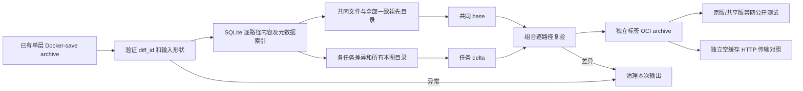

# 共享 base 离线转换与原版验证

日期：2026-10-23。生产 run 暂停，本次只实现本地原型和公开测试对照；不改生产默认镜像、不调用教师、不推送远程镜像。

## 流程与实现



实现文件：[转换器](../../tools/shared_base.py)、[原版对照工具](../../tools/benchmark_shared_base.py)、[独立指纹回归测试](../../tests/images/test_shared_base.py)。均使用标准库。源输入保持不变，输出目录存在时拒绝覆盖，失败时先关闭 SQLite 再清理本次新建目录。

共享需要文件内容、类型、权限、UID/GID、时间、链接和 PAX 扩展属性均相同，且每个祖先目录显式存在并在各镜像元数据相同。目录在各 delta 中重新输出，硬链接及引用目标同留 delta。whiteout、特殊/稀疏文件、非法/重复归一化路径、多层和错误 diff_id 拒绝。相同 tag 的不同源仓库用源身份摘要消歧，真正重复的源标签拒绝。

配置除派生的 rootfs diff_ids/history 外保留；OCI annotation 写完整规范镜像名，报告记录本地短标签，两者可由 Docker 的名称归一化对应。输出 `index.sqlite3` 是镜像文件保真索引，不改 A/B/C 训练索引或准入结果。

## 三镜像实测

最终本地收据：[转换报告](../../results/shared_base_probe/converted-v5/report.json)、[原版对照报告](../../results/shared_base_probe/benchmark-v3/benchmark.json)。派生报告、SQLite、镜像和日志按规则不提交。

| 实例 tag | 原压缩层 B | delta B | 原版与共享版公开测试 |
|---|---:|---:|---|
| mattrobenolt_jinja2-cli_pr118 | 435,582,344 | 42,757,168 | 2 passed / exit 0 |
| matrix-org_matrix-python-common_pr29 | 472,448,127 | 79,547,766 | 7 passed / exit 0 |
| facelessuser_soupsieve_pr140 | 453,469,808 | 60,530,149 | 564 passed、相同 2 failure / exit 1 |

共同 base 384,758,483 B，压缩总量 1,361,500,279 → 567,593,566 B，减少 **58.31%**。28,612 个共同条目；三图逐路径复验分别 40,516 / 45,442 / 41,141 项，缺失/改变/多余均为 0。Docker Config、Python 版本、pip freeze、Git HEAD/状态与每个公开 testcase 状态一致。soupsieve 的两条原有失败是两个 test_defined_xhtml（TestDefined 与 TestDefinedQuirks）；它们在两个版本均失败，不算全测试通过。

本地 HTTP 实际传输总量等于上述压缩总量，时间 8.205 → 6.244 s（约 1.31 倍）；第一张仍需 base，第二/三张各命中一次 base 缓存。该测试不是 Docker Hub 拉取性能。转换 71.20 s；共享镜像加载 51.64 s，加载时 Docker 已有缓存，没有原版冷缓存对照。未压缩层载荷 3,647,518,720 → 1,527,736,320 B，也不代表 vhdx 即刻回收。

## 验证与使用

```powershell
python tools/shared_base.py results/shared_base_probe/originals.tar --output results/shared_base_probe/converted-new
python tools/benchmark_shared_base.py --converted results/shared_base_probe/converted-new --original-archive results/shared_base_probe/originals.tar --output results/shared_base_probe/benchmark-new
python -m unittest discover -s tests/images -p 'test_*.py' -q
python -m pytest tests/pools -q
python results/build_index_db.py --check
git diff --check
```

验证结果：45 项转换器 unittest、32 项池回归通过，索引校验通过。pytest 有现有环境的 `Unknown config option: asyncio_mode` 警告。三组公开容器对照均正常完成并逐项一致。

## 限制与踩坑

- 初版夹具改 layer/config 后没有重打包、repack 覆盖修改后的 manifest，造成错误的拒绝测试结论；现已修正。Windows 失败路径必须关闭 SQLite，避免 WinError 32。
- 初版 OCI 名称曾 load 成功却 inspect 不到，需规范化 containerd annotation；最终真实 load/inspect 对照已通过。
- 最终祖先目录规则比早期版本保守，共享率从早期 64.1% 调整为最终 58.31%，只以最终结果验收。
- 三图共享率不能外推全队列，需要按稳定系统环境分组并重新验收。原型保存未压缩中间层，临时占用会上升。
- 未转换的任务仍需获得完整原镜像。要加速后续消费者，需另行准备并分发共享产物或预加载本地标签；当前剩余队列尚未切换，也未因本次原型恢复生产。
