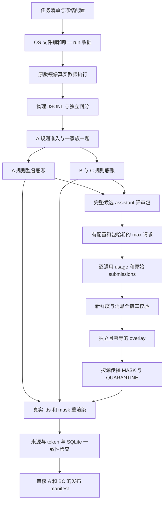

# 正式池恢复、全量审核与训练发布的证据门

日期：2026-10-23。状态：工程防护及针对性测试已落地，正式生产和全池审核持续运行。本文不把中间池数或 mock 测试当作最终发布验收。

## 目标与边界

正式目标是 `pool_a_formal/batch_*/**/trajectories.jsonl` 中 2000 个唯一实例，包含失败并单列基础设施错误；pilot 等其他协议的数据不加入正式数。教师续写失败种子不算 B 训练对。训练准入保持同家族至多一题、固定验证家族不回流、工具观察 loss 为零，hidden judge 只供独立判分。

生产继续使用原版任务镜像和原教师配置：`deepseek-flash`、thinking enabled、low、8192 输出上限、60 步。语义审核请求 `deepseek-flash/max`，输出上限另设为 65536；两种配置不得混为同一个协议。请求记录只证明客户端请求，不证明服务内部推理配置。

## 数据流



## 主要修改

- `results/run_formal_batches.py`：OS 文件锁、每 run 独立目录和日志、任务/配置/生产源码 SHA 收据；按轨迹物理行恢复；末批按剩余额度裁剪；拉取超时和有限重试；只有明确不存在的 tag 才进入永久 missing；预取异常回传；factory 非零或全批零步零 assistant 熔断。清理只涉及本 run 拉入的、不在使用中的镜像，不强删、不全局 prune 容器或卷。
- `results/formal_export.py`、`results/build_index_db.py`：JSONL 按物理换行读取，避免 U+2028/U+0085 在字符串内部被 `splitlines()` 错拆；恢复 A 的家族上限；导出记录 `formal-v2-family-cap-one` 及源码 SHA，原始 first-record-wins 与失败收据保留。
- `results/bc_export.py`：保存独立 `a_rule_ledger.jsonl` 和 `bc_rule_ledger.jsonl`；监督白名单先组合审核结果再重新渲染。overlay 必须与标签和底账 SHA 一致；C3 只有完整新鲜审核后才可能获得训练资格。B 必须是同一轨迹内部的真实失败、源码修改、原失败测试重跑通过，不能拼接独立重试。
- `results/model_review.py`：所有候选 assistant 的内容、reasoning 和原生工具参数完整送审；工具观察保首尾合计 2500 字符，保留原长度、哈希和截断提示。全监督消息覆盖不等于全部工具观察逐字审核。严格 compose 逐一重建包、核对配置和标签覆盖；A 与 BC 一起审核，避免坏动作从 A 绕回。
- `results/model_review_bulk.py`：只有包 SHA、请求配置 SHA 及 schema 同时匹配才复用；错 packet_id 不能强行覆盖；收到的每次 usage 先记账，解析失败也计入。`finish_reason=length` 立即失败，不原预算重复三次；CLI 有失败必须非零退出。
- `results/reviewed_export.py`：独立发布已审 A payload、发布底账和各池入口 manifest；原 A 基线与 B 教师种子仅作审计；SQLite 新表登记发布元数据，避免手改数据库制造数量。

## 审核语义

QUARANTINE 隔离同一源轨迹的全部视图。明确 MASK 的动作按消息编号同步从 A/B/C 监督中移除，包括整包为 REVIEW 但仍明确标坏的动作。消息 REVIEW 只暂停该视图的对应消息，整包 REVIEW 暂停该视图全部监督；证据不足不等同于跨视图污染。

只缩监督，保留真实上下文，不伪造工具结果。缩完为空的样本拒绝；工具、system、user 的 token 不计算损失。发布清单按 `instance_id` 记录多视图归属，不把视图数当成独立任务数，不在此自定混训比例。

## 已见故障与验证

1. 旧的批 028 有 15 个零步错误，根因未证实。不得删除坏目录让重试盖过 first-wins；应保留来源并显式建立重试更正链。
2. 旧 review packet 文件名含冒号曾写入 Windows ADS；文件名需规范化。
3. 原 max 试跑三次 8192 completion 全部耗在 reasoning，无 JSON。提高到 32768 后，同一包真实成功：20936 prompt、24430 completion，其中 23507 reasoning，返回 stop 并通过 22 条消息的覆盖校验。随后 32768 的 24 包试跑为 22 通过、2 包仍 length，故正式审核统一提高到 65536 并另记配置收据。不能把 high/window 历史标签当本次 max/full-assistant 验收。
4. SQLite 新增请求配置和源身份列，显式列名写入，测试覆盖从旧表迁移和重复登记；台账仍为权威。
5. `Rendered` 对 token 和 mask 的真实重算必须运行，不能仅比较行数；真实 `Renderer.render()` 返回文本，不是有 `.mask()` 的对象，发布适配已区分。单条真实轨迹验证：ids 保持 18832 token，删去一个监督消息后监督 6396→5863，span 校验通过；仍不是全池发布验收。

已通过 `python -m pytest tests/pools -q` 的 68 项回归；唯一 warning 为环境未注册 `asyncio_mode` 配置。中间 A 索引 `python results/build_index_db.py --check` 通过：1790 条、687 准入、15503157 序列 token。数字是冻结的中间底账，不代表当前持续写入中的轨迹总数。

## 最终验收步骤

生产到量退出后再冻结最终来源，顺序执行：

```text
formal_export.py
build_index_db.py → build_index_db.py --check
bc_export.py
model_review_bulk.py --build
model_review_bulk.py --run --effort max --max-tokens 65536
model_review_bulk.py --ingest
model_review.py --apply
bc_export.py --mask-overlay results/pool_bc/review/overlay.json
reviewed_export.py
bc_export.py --check
model_review.py --check
reviewed_export.py --check
```

每一步检查退出码；没有足够覆盖则停止发布。最终还要核验家族隔离、消息来源、token mask、payload SHA、SQLite 逐项一致，以及全部发布候选的当前审核。当前没有训练收益证据。
