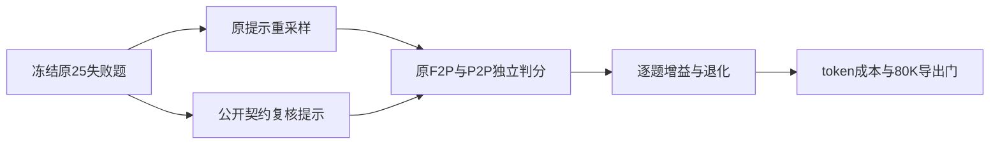

# 池 A 五十题与 80K 窗口

复核修订：2026-10-21。原始实验目录保持不变；本次依据逐节点判分和实际导出序列，纠正旧版报告中混淆 F2P/P2P、错误排除 infra、长度估算以及过度归因的结论。旧稿可追溯至提交 `8663166`，不能继续作为“19/25 契约猜错”的证据。

## 1. 原 50 题的已证实结果

原始 run：[deepseek-flash_20261020_235140](<E:/Deeplearning/local_train/swefactory_self/results/pool_a50/deepseek-flash_20261020_235140>)。教师为 `deepseek-flash`、low effort、每次输出8192、最多60步、并发6，使用 DSH 适配器的 bash/read/edit 和自然结束。81920 是**导出长度门**，没有提高教师的步数或输出预算。

| 指标 | 核验值 |
|---|---:|
| 正常保存的题目 / 通过 | 50 / 25 |
| 失败题目 | 25 |
| 最终失败记录含 evaluator error | 0 |
| 旧导出器保留候选 | 25 |
| 导出总 token / 监督 token | 673467 / 256429（38.08%） |
| 每候选平均 token | 26938.68 |
| 最短 / 中位 / 最长实际序列 | 3986 / 25110 / 78573 |
| p90 实际序列（最近秩） | 51202 |
| 按32768长度门会拦下 / 按81920会拦下 | 8 / 0 |

上表长度直接取保留文件中的 `len(ids)`。旧稿的“最长79670、32K丢9条”是逐消息内容分别分词相加的近似数，包含原生调用JSON格式开销、缺少模板边界，不能当实际长度门的结果。`tool_blocks=1087` 实际是所有角色的消息块数，不是工具调用次数。

这50题来自本地158条头部样本中**按顺序选择未使用题**，并非全题库随机样本。qontract-reconcile占26题（12通过、14失败），beets占10题（5通过、5失败）。因此50%不是全库生产成品率，也不能和上一组不同题集的14/22直接比较为配置效果。这里只能确认同一批样本在不同导出长度门下的保留差异。

导出的25条是按旧导出器 success/think/长度规则得到的**候选**，不等于已经完成全部训练准入门：工具schema入模板、监督mask、后置验证、去重与基准隔离仍需单独验收。80K训练的显存和吞吐未验证。

## 2. 失败程度：必须分开 F2P 和 P2P

方法：把数据集声明的 FAIL_TO_PASS、PASS_TO_PASS 分别与每题最终 `eval_result.details.matched` 按节点ID关联；不再用 pytest 总通过数代替修复进度。

| 原25条失败的测试集合 | 通过 | 失败 |
|---|---:|---:|
| F2P（本次需要修好的目标） | 28 | 52 |
| P2P（原本通过、不能破坏的回归） | 3278 | 4 |

12题一个 F2P 都没有修好。cookiecutter_pr974 的 F2P 2/2已通过，但破坏4个 P2P。其余24题都至少有一个 F2P 失败。

所以，“21/25只差1–3个测试节点”即使在数量上成立，也**不能推出接近正确**：许多通过节点本来就是 P2P。例如 pr1125 的26个通过全部是回归测试，目标测试0/3。

25题都有 [.gitignore](<E:/Deeplearning/local_train/swefactory_self/.gitignore>) 以外的文件差异；补丁非空不证明改动方向正确。最终patch未检测到测试路径修改，也不证明轨迹期间从未改过测试。只有pr971达到60步；这不等于预算对所有任务都无影响。

## 3. 更正 pr1008 的 infra 归因

pr1008 最终记录中 evaluator error 为空，存在完整判分输出：F2P 0/3，P2P 28/28。中途日志出现镜像拉取错误不能覆盖最终成功执行测试的收据，也不能据此把这题从分母排除。原run仍为25/50，不改成25/49。

基础设施错误与模型失败仍须分开统计，但要依最终失败阶段、异常和是否真正执行判分判断，而不是仅匹配一条旧日志。后续复测单列缺失轨迹和 evaluator error，不把它们硬归为语义失败。

## 4. 逐题复核：公开需求与失败现象

以下“失败现象”来自原独立判分，仅用于事后分析，不加入复测教师提示。最后一列是公开 issue 可支持的核对方向，**不是已证实的唯一根因**。名称没写在issue里，不等于仓库中也无法推断；AttributeError也可能是测试依赖内部实现，必须另行判断。

| 题目 | 旧F2P | 旧P2P | 最终失败现象 | 公开需求支持的核对方向 |
|---|---:|---:|---|---|
| qontract_pr1125 | 0/3 | 26/26 | 发送字符串items、POST次数不符、空列表仍POST | issue明确要求逐个发送对象；检查wrapper解包、空列表和单/多元素 |
| qontract_pr1914 | 1/2 | 65/65 | schedule用户名选择断言失败 | issue明确UTC时窗、start/end/users；应核对时间与成员合并，不据空摘要断定隐藏契约 |
| qontract_pr1008 | 0/3 | 28/28 | 补ID的日志/调用缺失、CLI外部ID列未正确输出 | issue明确回填id/external_id、创建MR、CLI列和排序；不能归为infra |
| qontract_pr1195 | 4/5 | 29/29 | SmtpClient缺user成员 | issue明确SmtpClient(settings)和多实例隔离；user这个具体成员名未由issue指定，测试实现耦合待核 |
| qontract_pr1016 | 3/5 | 26/26 | skipper模块缺测试patch目标 | issue明确新CLI、skip-ci、yes/no输出；内部patch目标名不能直接认定为公开API |
| beets_pr4634 | 1/3 | 481/481 | Mock不可下标访问 | issue明确item_candidates签名、TrackInfo、最多10项；核对真实API对象和返回结构 |
| qontract_pr931 | 0/2 | 23/23 | 未按预期SystemExit | issue明确SaaS resourceTemplates加入既有验证；检查完整输入结构和既有报错方式 |
| qontract_pr971 | 4/5 | 25/25 | 缺get_dns_zones | issue明确GraphQL、dry-run、CLI和部署配置；并未指定该helper名称，不能把该名称偷偷补进提示 |
| defopt_pr70 | 0/1 | 98/98 | 单字符串构造类未找到parser | issue含明确构造函数注解与CLI示例；检查类型识别及parser选择路径 |
| preliz_pr45 | 3/5 | 9/9 | fit_moments与NotImplementedError契约不符 | issue要求新增分布和适用的拟合方法；未实现例外与数值行为需结合库惯例核验 |
| qontract_pr360 | 1/3 | 24/24 | 缺get_raw_owners_content | issue明确fetch失败停机和owners请求重试；没有指定此helper名称，不能只据ImportError判断行为未实现 |
| beets_pr5301 | 0/4 | 505/505 | 废弃函数静态检查、旧版本行为失败 | issue明确bash-completion兼容；一条摘要把注释也识别为废弃调用，可能混有静态测试约束，不能全算语义错误 |
| qontract_pr578 | 1/4 | 24/24 | queries缺特定查询helper | issue明确项目自动发现及逐项目enable_rebase；helper名未指定，需检查既有query/调用规范 |
| beets_pr5540 | 0/1 | 486/486 | 缺unique_list | issue要求beet write幂等，不要求该helper；隐藏测试可能依赖实现形式，未证明替代修复不可行 |
| qontract_pr981 | 3/8 | 22/22 | bool不可解包、标签调用不符 | issue明确hold/hold cancel/lgtm副作用；检查既有调用点的返回形状与完整标签状态机 |
| qontract_pr1901 | 0/1 | 63/63 | 忽略资源配置的日志断言失败 | issue明确init_specs_to_fetch日志需求；应核对被忽略项是否全部覆盖，摘要不足以确认细节 |
| pyedb_pr336 | 1/2 | 26/26 | set_position_and_rotation调用断言 | issue明确position_x/y参数；应核对新增参数是否传递到实际对象操作 |
| beets_pr4504 | 0/1 | 499/499 | 预期输出文件未生成 | issue明确默认不限制和None禁用；检查端到端转换行为，不能凭文件缺失排除环境因素 |
| qontract_pr850 | 0/3 | 26/26 | enable_rebase KeyError | issue列出逐仓库字段/默认值；enable_rebase未列在新增字段中，需核对现有调用依赖与兼容默认值 |
| beets_pr5457 | 0/2 | 526/526 | extract_lyrics新增必填参数导致签名不兼容 | issue要求直接构造URL，未要求破坏原调用签名；重点核对旧调用者 |
| preliz_pr162 | 0/6 | 104/104 | ValueError缺失、部分初始化NoneType等 | issue明确数组参数报错、全部参数已定义才freeze；这是可见行为要求，不应全归为猜隐藏接口 |
| qontract_pr976 | 0/3 | 26/26 | 缺follow_logs相关patch目标 | issue明确publishJobLogs/io_dir/Job日志；helper名称未指定，属于实现耦合待核 |
| qontract_pr1058 | 2/3 | 27/27 | Deployment.apps仍报非预期warning | issue含相同复现值及预期无warning；重点核对kind/group解析和匹配 |
| seqrepo_pr172 | 2/3 | 27/27 | 缺_check_rsync_binary | issue明确openrsync启动检查和提示，但未指定函数名称；该命名依赖不能作为提示新增要求 |
| cookiecutter_pr974 | 2/2 | 83/87 | None与空列表的旧行为回归 | issue要求执行多个hook；同时必须保留原无hook返回语义；这是可见回归，反证“所有失败都因隐藏要求” |

qontract是app-sre_qontract-reconcile，preliz是arviz-devs_preliz；完整instance_id保留在下方复测表和原始JSON中。

## 5. 撤回旧版的过度结论

- “19/25契约、9条纯语义且有重叠”没有逐题多标签记录支持，旧分类计数也对不上，不再使用。
- “引用过测试路径、出现pytest命令”不能证明读过相关测试正文、运行成功、或最后一次修改后验证过。
- 隐藏F2P并非全部不在仓库：如pr1914的失败节点位于既有reconcile/test路径。是否新增隐藏测试应逐节点判断。
- “失败主因是不可推断的隐藏契约”“50%是契约猜中率”“只差几个边界断言”均未得到对照证实，不据此修改题目或排除任务。
- 独立重采样的旧失败/新成功不能直接拼为池B纠错：新教师没有看到旧失败上下文，缺少连续修正的因果链。

## 6. 本轮完善方式与验证设计

新增可选的 `public-contract-v1` 通用核对流程：只从公开issue和当前仓库提取要求，检查明确名称/位置/签名、返回结构、None/空值/异常、调用者兼容、相关CLI/配置和副作用；运行由公开要求导出的最小直接检查；结束前对照diff及最后一次修改后的验证。

不添加按题定制的隐藏符号名，不展示隐藏测试/参考补丁，不修改原判分规则，不改变三个工具schema或自然停止。开关默认关闭。

对原25条失败题开展两臂各一次独立采样：

- control：原提示重试；测量不改代码只重采样能恢复多少。
- contract：只附加通用核对流程；其余教师、预算、环境与判分配置相同。

两臂均保留60步、每次输出8192、low effort、并发6、基础设施异常重试上限3。长度门仍为81920，原run和输入指纹冻结。只在失败子集上复测，结果不能直接称为原50题的新通过率，也不能证明跨题库收益。

六项stdlib unittest已通过（默认提示逐字不变、工具与停止不变、隐藏元数据隔离、配置开关、用户任务提示隔离、F2P/P2P分类）。工厂venv没有pytest，原有pytest套件未执行成功。首次启动因本地CRLF/LF指纹校验退出，尚未请求教师，修正后运行。

复现入口为 [contract_experiment.py](<E:/Deeplearning/local_train/swefactory_self/recipes/scale_swe/contract_experiment.py>)，证据保存在 [contract_retry_v1](<E:/Deeplearning/local_train/swefactory_self/results/contract_retry_v1>)。工程实现说明另见 [公开契约复核与失败题对照复测](工程问题/2026-10-21-公开契约复核与失败题对照复测.md)。

## 7. 完整复测结果：本版通用契约增强未提效

两臂各25题全部完成，最终 evaluator error、缺失轨迹、额外实例重试均为0。control run为`deepseek-flash_20261021_004932`，contract run为`deepseek-flash_20261021_010100`。

| 指标 | 原提示重采样 control | 通用契约增强 contract |
|---|---:|---:|
| 完整题目通过 | 2/25（8%） | 1/25（4%） |
| F2P通过 | 35/80 | 33/80 |
| P2P通过/总数（失败数） | 3278/3282，失败4 | 3278/3282，失败4 |
| LLM调用 / 步数合计 | 883 | 782 |
| API累计输入token | 28280725 | 22486827 |
| API累计输出token | 484649 | 462585 |
| 每条通过所耗输出token（含失败题成本） | 242324.5 | 462585 |
| 80K门后保留候选 | 2 | 1 |
| 候选序列token / 监督token | 70224 / 32135 | 49741 / 19548 |
| 候选最长序列 | 48863 | 49741 |
| 超长 / 无think丢弃 | 0 / 0 | 0 / 0 |

API累计输入是多轮请求重复携带上下文的服务端token记账；候选序列是Qwen模板的独立序列长度，两者不能混用。部分通过记录只保存成功marker，其F2P/P2P聚合通过数据 evaluator 接受推定，并非额外取回了逐节点XML。

契约组输入减少20.49%、输出减少4.55%、调用减少11.44%，但通过数从2变1，**每条通过的输出成本增加90.90%**。因此不能把总token更少写成数据制造提效。没有实际计费金额、缓存折扣和训练吞吐测量，不据此计算货币节省。

### 7.1 25题逐题对照

F2P/P2P栏分别为通过数/声明总数。所有原题均是原run失败子集；“仅契约通过”不代表相对原50题新增的总体通过率。

| 完整instance_id | 原F2P | 对照F2P/P2P | 契约F2P/P2P | 两臂判分 | 步数 对照→契约 |
|---|---:|---|---|---|---:|
| app-sre_qontract-reconcile_pr1125 | 0/3 | 3/3 / 26/26 | 0/3 / 26/26 | 仅对照通过 | 21→11 |
| app-sre_qontract-reconcile_pr1914 | 1/2 | 1/2 / 65/65 | 0/2 / 65/65 | 均失败 | 42→50 |
| app-sre_qontract-reconcile_pr1008 | 0/3 | 0/3 / 28/28 | 0/3 / 28/28 | 均失败 | 37→40 |
| app-sre_qontract-reconcile_pr1195 | 4/5 | 4/5 / 29/29 | 4/5 / 29/29 | 均失败 | 35→28 |
| app-sre_qontract-reconcile_pr1016 | 3/5 | 3/5 / 26/26 | 3/5 / 26/26 | 均失败 | 37→30 |
| beetbox_beets_pr4634 | 1/3 | 2/3 / 481/481 | 2/3 / 481/481 | 均失败 | 15→25 |
| app-sre_qontract-reconcile_pr931 | 0/2 | 2/2 / 23/23 | 0/2 / 23/23 | 仅对照通过 | 38→34 |
| app-sre_qontract-reconcile_pr971 | 4/5 | 4/5 / 25/25 | 4/5 / 25/25 | 均失败 | 60→60 |
| anntzer_defopt_pr70 | 0/1 | 0/1 / 98/98 | 0/1 / 98/98 | 均失败 | 28→17 |
| arviz-devs_preliz_pr45 | 3/5 | 4/5 / 9/9 | 3/5 / 9/9 | 均失败 | 53→30 |
| app-sre_qontract-reconcile_pr360 | 1/3 | 1/3 / 24/24 | 1/3 / 24/24 | 均失败 | 18→13 |
| beetbox_beets_pr5301 | 0/4 | 0/4 / 505/505 | 0/4 / 505/505 | 均失败 | 43→31 |
| app-sre_qontract-reconcile_pr578 | 1/4 | 1/4 / 24/24 | 1/4 / 24/24 | 均失败 | 43→30 |
| beetbox_beets_pr5540 | 0/1 | 0/1 / 486/486 | 0/1 / 486/486 | 均失败 | 45→60 |
| app-sre_qontract-reconcile_pr981 | 3/8 | 4/8 / 22/22 | 4/8 / 22/22 | 均失败 | 25→24 |
| app-sre_qontract-reconcile_pr1901 | 0/1 | 0/1 / 63/63 | 0/1 / 63/63 | 均失败 | 34→41 |
| ansys_pyedb-core_pr336 | 1/2 | 1/2 / 26/26 | 2/2 / 26/26 | 仅契约通过 | 60→44 |
| beetbox_beets_pr4504 | 0/1 | 0/1 / 499/499 | 0/1 / 499/499 | 均失败 | 16→8 |
| app-sre_qontract-reconcile_pr850 | 0/3 | 0/3 / 26/26 | 0/3 / 26/26 | 均失败 | 23→28 |
| beetbox_beets_pr5457 | 0/2 | 0/2 / 526/526 | 0/2 / 526/526 | 均失败 | 53→20 |
| arviz-devs_preliz_pr162 | 0/6 | 0/6 / 104/104 | 3/6 / 104/104 | 均失败 | 60→55 |
| app-sre_qontract-reconcile_pr976 | 0/3 | 0/3 / 26/26 | 0/3 / 26/26 | 均失败 | 45→36 |
| app-sre_qontract-reconcile_pr1058 | 2/3 | 2/3 / 27/27 | 2/3 / 27/27 | 均失败 | 20→19 |
| biocommons_biocommons.seqrepo_pr172 | 2/3 | 1/3 / 27/27 | 2/3 / 27/27 | 均失败 | 24→33 |
| audreyr_cookiecutter_pr974 | 2/2 | 2/2 / 83/87 | 2/2 / 83/87 | 均失败 | 8→15 |

逐题比较是新增1、退化2、共同失败22、共同通过0。只有3个不同结果的配对；探索性精确配对检验双侧p=1.0。**这次没有观察到收益，样本也不足以证明通用契约提示普遍有害。**

### 7.2 三条关键补丁复核

- **新增 pyedb_pr336**：契约组只给公开create方法新增position_x/y，并在创建后调用set_position_and_rotation；对照组扩展protobuf消息构造、兼容分支及旧参数顺序，仍漏掉一个目标检查。契约组本题更简洁且过门，但不能仅凭这一题证明提示机制有效。
- **退化 pr1125**：对照补丁识别manifest.data可能是带items的字典，并处理空列表；契约组直接遍历manifest.data，字典时就遍历键，目标测试0/3。这是实际输入结构未核准，不是“隐藏名字猜不中”。
- **退化 pr931**：对照补丁把SaaS仓库加入实际JJB仓库验证路径；契约组只扩展permissions-validator路径，未覆盖被测的仓库注册验证入口。加了核对流程文字，并不保证模型找到了真实执行入口。

preliz_pr162从对照0/6改善到3/6，仍未完整过门；cookiecutter两臂都保留4个旧回归。必须保留这些局部变化，不能只报唯一新增成功。

### 7.3 采用决定、限制与工厂状态

**保留原默认提示，不启用public-contract-v1作为默认采集配置。**新增提示仍以默认关闭的开关保存，便于复现这次负结果；不降低判分门、不扩大长度门，也不把两臂独立轨迹拼成纠错示范。

新增3条独立过门候选都能落在80K内，但只按既有导出器转换，尚不宣称完成所有训练验收。旧50题run、两臂结果、逐题补丁与指纹均保留。

本次新增50次完整任务尝试，合计1665次LLM调用、API累计输入50767552、输出947234；日志未发生额外实例重试，日志token与保留轨迹stats一致。首次本地换行指纹预检失败未调用教师，不计入这50次尝试。

限制：只在已知失败子集上各采样一次，两臂顺序运行，无固定随机seed，未覆盖旧成功题的回归影响。本轮保持旧工具实现以控制变量，复核另发现file工具继承全局/testbed而非实例/workspace路径时会拒绝有效路径：对照已有4次workspace拒绝和1次错路径找不到文件，不能把所有工具问题都归为模型错误。此缺陷没有在两臂间途中新改。

原镜像的构建元数据也可能含晚于base commit的文件名或文案，需在后续任务资格验证中检查；当前只记风险，不据此把失败删掉或计为新增成功。

证据入口：[manifest.json](<E:/Deeplearning/local_train/swefactory_self/results/contract_retry_v1/manifest.json>)、[comparison.json](<E:/Deeplearning/local_train/swefactory_self/results/contract_retry_v1/comparison.json>)、[analysis_summary.json](<E:/Deeplearning/local_train/swefactory_self/results/contract_retry_v1/analysis_summary.json>)、[paired_table.md](<E:/Deeplearning/local_train/swefactory_self/results/contract_retry_v1/paired_table.md>)、[key_case_patches.md](<E:/Deeplearning/local_train/swefactory_self/results/contract_retry_v1/key_case_patches.md>)，以及control/contract两个原生run的完整轨迹与独立判分。
